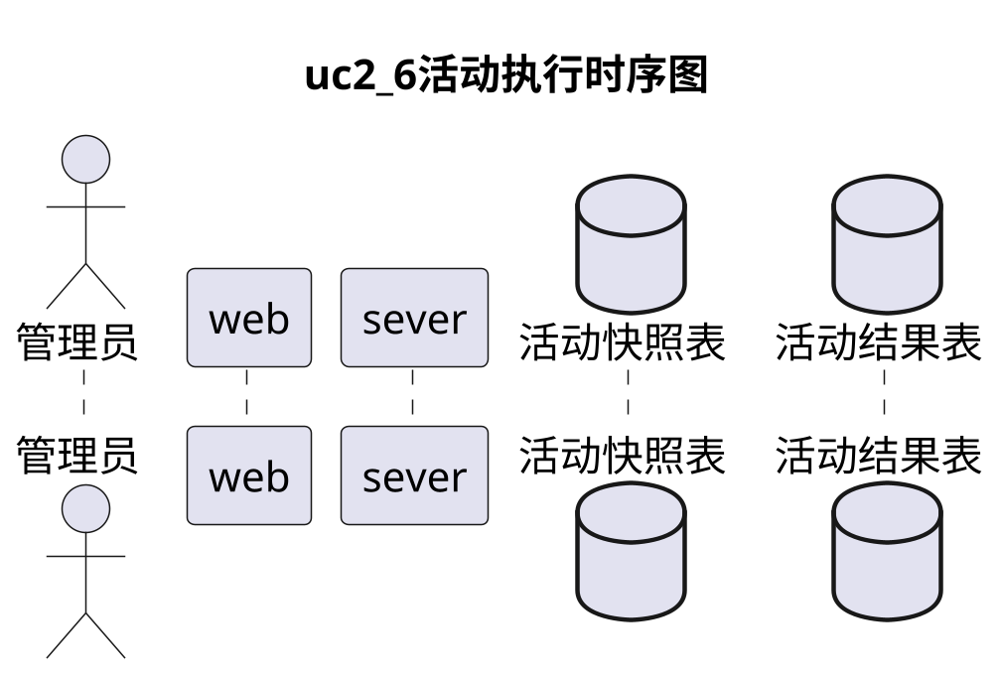
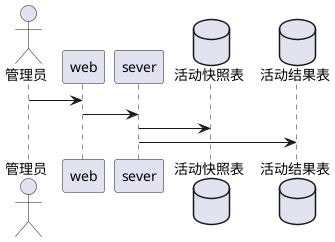

# Case E053

Diagram type: sequence · tier 1 · outcome: compiled low-structural
Image: `E053.png`

## Ground truth

## Answer (1 display-only lines removed; they are in `E053.stripped.txt`)

## Structural diff

Element F1 1.000 · Relationship F1 0.000

- nodes matched (5): `???`, `?????` ×2, `sever`, `web`
- nodes missed (0): none
- nodes spurious (0): none
- edges matched (0): none
- edges missed (0): none
- edges spurious (4): `??? -> web : message`, `sever -> ????? : message` ×2, `web -> sever : message`
