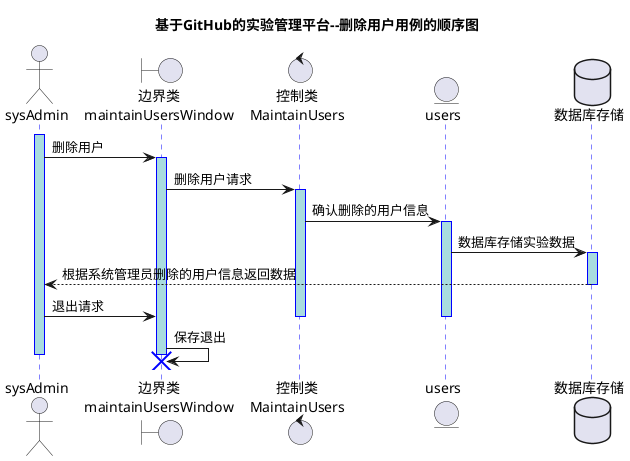
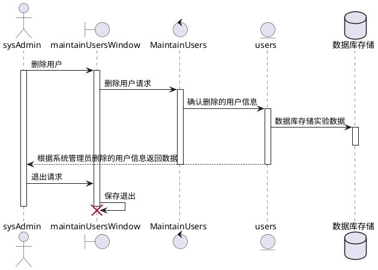

# Case E054

Diagram type: sequence · tier 3 · outcome: compiled low-structural
Image: `E054.png`

## Ground truth

## Answer (1 display-only lines removed; they are in `E054.stripped.txt`)

## Structural diff

Element F1 0.600 · Relationship F1 0.143

- nodes matched (3): `?????`, `sysadmin`, `users`
- nodes missed (2): `??? maintainusers`, `??? maintainuserswindow`
- nodes spurious (2): `maintainusers`, `maintainuserswindow`
- edges matched (1): `users -> ????? : message`
- edges missed (6): `??? maintainusers -> users : message`, `??? maintainuserswindow -> ??? maintainusers : message`, `??? maintainuserswindow -> ??? maintainuserswindow : message`, `????? -> sysadmin : message`, `sysadmin -> ??? maintainuserswindow : message` ×2
- edges spurious (6): `maintainusers -> users : message`, `maintainuserswindow -> maintainusers : message`, `maintainuserswindow -> maintainuserswindow : message`, `sysadmin -> maintainuserswindow : message` ×2, `users -> sysadmin : message`
