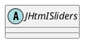

# Case E055

Diagram type: class · tier 1 · outcome: compiled low-structural
Image: `E055.png`

## Ground truth

## Answer (0 display-only lines removed; they are in `E055.stripped.txt`)

## Structural diff

Element F1 0.000 · Relationship F1 1.000

- nodes matched (0): none
- nodes missed (1): `jhtmlsliders`
- nodes spurious (1): `jhtmisliders`
- edges matched (0): none
- edges missed (0): none
- edges spurious (0): none
