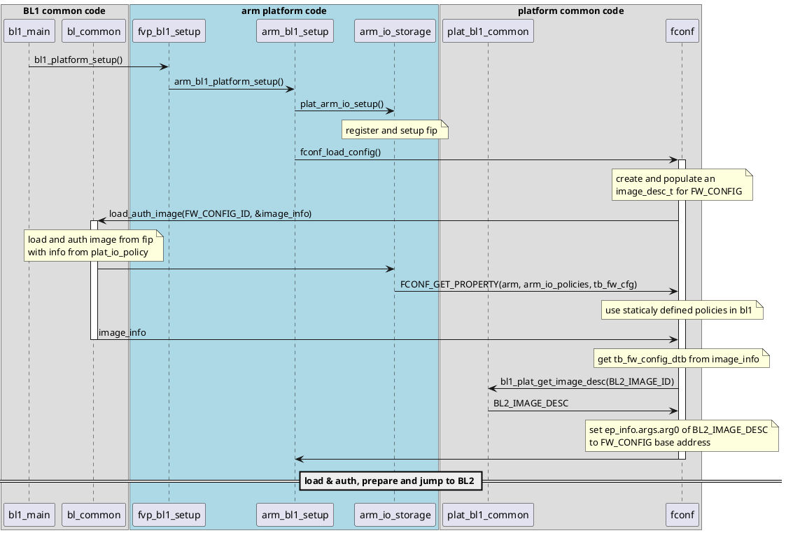
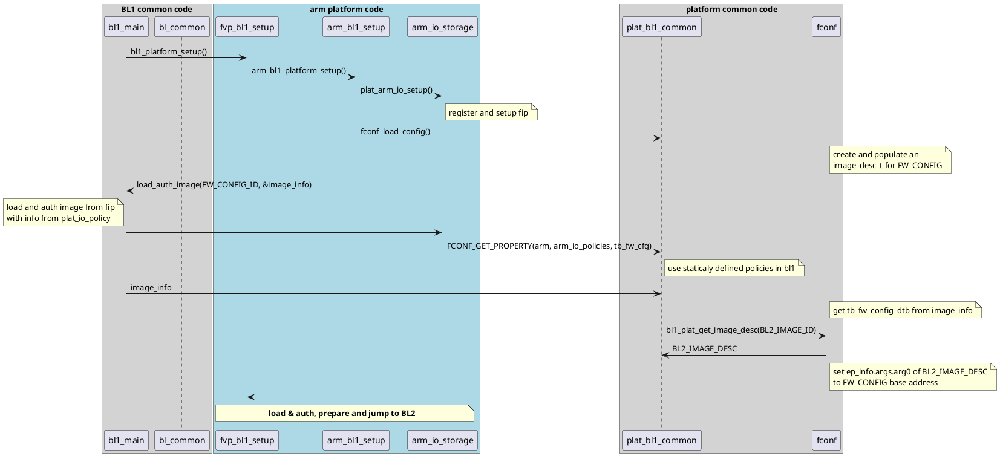

# Case E056

Diagram type: sequence · tier 4 · outcome: compiled low-structural
Image: `E056.png`

## Ground truth

## Answer (0 display-only lines removed; they are in `E056.stripped.txt`)

## Structural diff

Element F1 1.000 · Relationship F1 0.455

- nodes matched (7): `arm_bl1_setup`, `arm_io_storage`, `bl1_main`, `bl_common`, `fconf`, `fvp_bl1_setup`, `plat_bl1_common`
- nodes missed (0): none
- nodes spurious (0): none
- edges matched (5): `arm_bl1_setup -> arm_io_storage : message`, `bl1_main -> fvp_bl1_setup : message`, `fconf -> plat_bl1_common : message`, `fvp_bl1_setup -> arm_bl1_setup : message`, `plat_bl1_common -> fconf : message`
- edges missed (6): `arm_bl1_setup -> fconf : message`, `arm_io_storage -> fconf : message`, `bl_common -> arm_io_storage : message`, `bl_common -> fconf : message`, `fconf -> arm_bl1_setup : message`, `fconf -> bl_common : message`
- edges spurious (6): `arm_bl1_setup -> plat_bl1_common : message`, `arm_io_storage -> plat_bl1_common : message`, `bl1_main -> arm_io_storage : message`, `bl1_main -> plat_bl1_common : message`, `plat_bl1_common -> bl1_main : message`, `plat_bl1_common -> fvp_bl1_setup : message`
