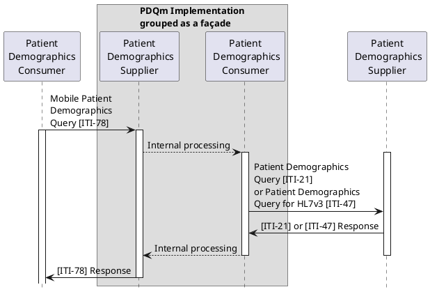

# Case E057

Diagram type: sequence · tier 2 · outcome: compile fail
Image: `E057.png`

## Ground truth



## Answer (0 display-only lines removed; they are in `E057.stripped.txt`)

```plantuml
@startuml

box "PDQm Implementation\ngrouped as a façade" #LightGray
participant "Patient\nDemographics\nSupplier" as PDSm
participant "Patient\nDemographics\nConsumer" as PDCi
end box

participant "Patient\nDemographics\nConsumer" as PDC order 1
participant "Patient\nDemographics\nSupplier" as PDS order 99

PDC -> PDSm : Mobile Patient\nDemographics\nQuery [ITI-78]

PDSm ..> PDCi : Internal processing

PDCi -> PDS : Patient Demographics\nQuery [ITI-21]\nor Patient Demographics\nQuery for HL7v3 [ITI-47]

PDS --> PDCi : [ITI-21] or [ITI-47] Response

PDCi ..> PDSm : Internal processing

PDSm --> PDC : [ITI-78] Response

@enduml
```

## Renderer

Renderer: error at line 13 of the answer block: `PDSm ..> PDCi : Internal processing`
