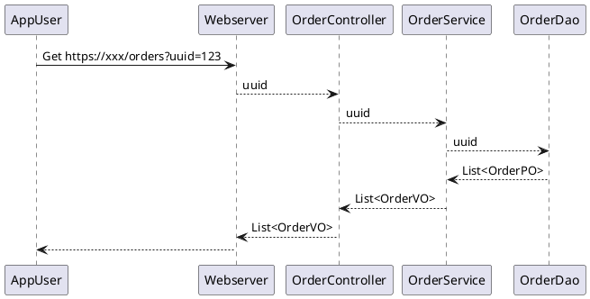

# Case E058

Diagram type: sequence · tier 1 · outcome: compile fail
Image: `E058.png`

## Ground truth



## Answer (0 display-only lines removed; they are in `E058.stripped.txt`)

```plantuml
@startuml
participant AppUser
participant Webserver
participant OrderController
participant OrderService
participant OrderDao

AppUser -> Webserver : Get https://xxx/orders?uuid=123
Webserver -..> OrderController : uuid
OrderController -..> OrderService : uuid
OrderService -..> OrderDao : uuid
OrderDao -..> OrderService : List<OrderPO>
OrderService -..> OrderController : List<OrderVO>
Webserver <..- OrderController : List<OrderVO>
AppUser <..- Webserver
@enduml
```

## Renderer

Renderer: error at line 9 of the answer block: `Webserver -..> OrderController : uuid`
