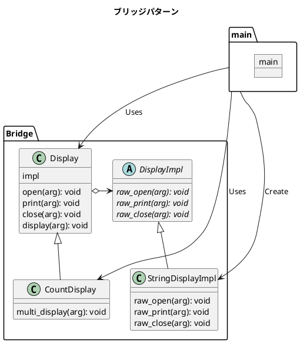

# Case E059

Diagram type: class · tier 3 · outcome: compile fail
Image: `E059.png`

## Ground truth



## Answer (4 display-only lines removed; they are in `E059.stripped.txt`)

```plantuml
@startuml


package "main" as PKG_MAIN {
  class main as MAIN
}

package "Bridge" as PKG_BRIDGE {

  abstract class Display << (C,#B7E1B0) >> {
    impl
    --
    open(arg): void
    print(arg): void
    close(arg): void
    display(arg): void
  }

  abstract class DisplayImpl << (A,#BFE9EA) >> {
    --
    {abstract} raw_open(arg): void
    {abstract} raw_print(arg): void
    {abstract} raw_close(arg): void
  }

  class CountDisplay << (C,#B7E1B0) >> {
    --
    multi_display(arg): void
  }

  class StringDisplayImpl << (C,#B7E1B0) >> {
    --
    raw_open(arg): void
    raw_print(arg): void
    raw_close(arg): void
  }

  Display o--> DisplayImpl
  CountDisplay --|> Display
  StringDisplayImpl --|> DisplayImpl
}

MAIN ..> Display : Uses
MAIN ..> StringDisplayImpl : Uses
MAIN ..> StringDisplayImpl : Create

@enduml
```

## Renderer

Renderer: error at line 9 of the answer block: `class main as MAIN`
