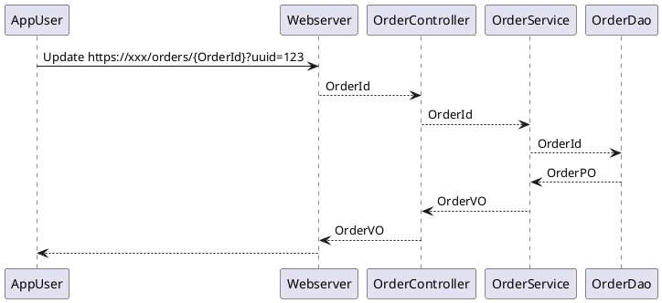
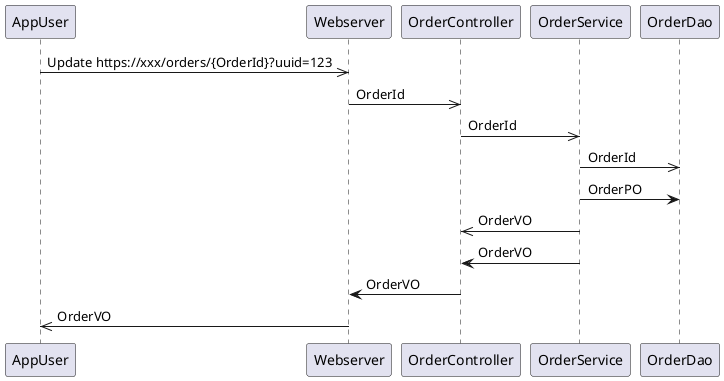

# Case E060

Diagram type: sequence · tier 1 · outcome: compile fail
Image: `E060.png`

## Ground truth

## Answer (1 display-only lines removed; they are in `E060.stripped.txt`)

## Renderer

Renderer: error at line 4 of the answer block: `participant "AppUser" as A`
