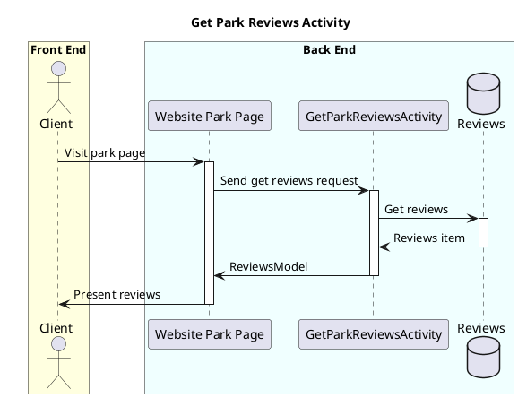
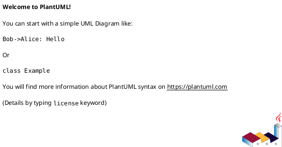

# Case E061

Diagram type: sequence · tier 2 · outcome: compile fail
Image: `E061.png`

## Ground truth

## Answer (768 display-only lines removed; they are in `E061.stripped.txt`)

## Renderer

The answer has no `@enduml`. Renderer: no PNG produced
