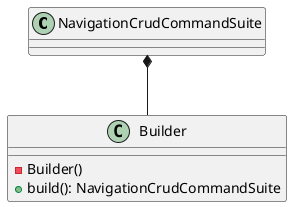

# Case E062

Diagram type: class · tier 1 · outcome: compiled low-structural
Image: `E062.png`

## Ground truth

```plantuml
' Blob ID: 7cbb0b646ccc6f79839a6f3bf478d104c064aef2
' Original Path: /malokhvii-eduard/malokhvii08/shell-extension-navigation-crud/doc/plantuml/ua/khpi/oop/malokhvii08/shell/navigation/crud/runtime/NavigationCrudCommandSuite.Builder.puml
' Source: World of Code

@startuml

    class NavigationCrudCommandSuite.Builder [[../ua/khpi/oop/malokhvii08/shell/navigation/crud/runtime/NavigationCrudCommandSuite.Builder.html]] {
        -Builder()
        +build(): NavigationCrudCommandSuite
    }

@enduml
```

## Answer (1 display-only lines removed; they are in `E062.stripped.txt`)

## Structural diff

Element F1 0.667 · Relationship F1 0.000

- nodes matched (1): `builder`
- nodes missed (0): none
- nodes spurious (1): `navigationcrudcommandsuite`
- edges matched (0): none
- edges missed (0): none
- edges spurious (1): `navigationcrudcommandsuite -> builder : composition`
