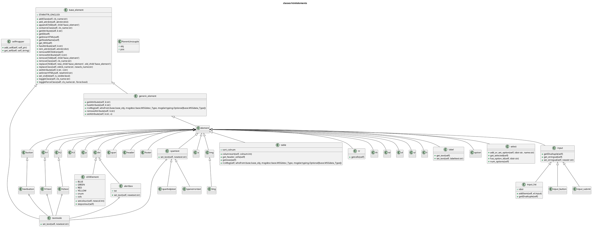

# Case E063

Diagram type: class · tier 4 · outcome: compile fail
Image: `E063.png`

## Ground truth



## Answer (1 display-only lines removed; they are in `E063.stripped.txt`)

```plantuml
@startuml

class "base_element" {
  + STARATTR_ONCLICK
  + addClass(self, cls, name:str)
  + add_attribute(self, attrid:dict)
  + appendChild(self, child:'base_element')
  + containClass(self, cls, name:str)
  + getAttribute(self, k, str)
  + getDocType()
  + getinnerHTML(self)
  + getbodyName(self)
  + get_White(self)
  + hasAttribute(self, k:str)
  + has_attribute(self, attrid:dict)
  + removeAttribute(self, k, str)
  + removeAllChildren(self)
  + removeChild(self, child:'base_element')
  + removeClass(self, cls, name:str)
  + replaceChild(self, new, child:'base_element', old_child:'base_element')
  + replaceClass(self, oldcls, newcls, name:str, newcls, name:str)
  + setAttribute(self, k, str, v)
  + setinnerHTML(self, newhtml:str)
  + set_visible(self, v, visible:bool)
  + toggleClass(self, cls, name:str)
  + toggleForceClass(self, cls, name:str, force:bool)
}

class "selfmapper" {
  + add_self(self, self, pstr)
  + get_self(self, self, str)
}

class "generic_element" {
  + getAttribute(self, k:str)
  + hasAttribute(self, k:str)
  + rcvMsg(self, whofrom:base_base_obj, msgdesc:base_MSGdesc_Type, msgdat:typing.Optional[base_MSGdata_Type])
  + removeAttribute(self, k, str)
  + setAttribute(self, k:str, v)
}

class "ParentIncouple" {
  o obj
  o pos
}

class "Element" {
}

class "button" {
}

class "h1" {
}

class "h2" {
}

class "h3" {
}

class "p" {
}

class "div" {
}

class "span" {
}

class "header" {
}

class "footer" {
}

class "spanhelp" {
  + set_text(self, newtext:str)
}

class "spaner" {
  + set_text(self, newtext:str)
}

class "a" {
}

class "img" {
}

... 1753 lines omitted ...
}

class "td" {
}

class "td" {
}

class "td" {
}

class "td" {
}

class "td" {
}

class "td" {
}

class "td" {
}

class "td" {
}

class "td" {
}

class "td" {
```

## Renderer

The answer has no `@enduml`. Renderer: no PNG produced
