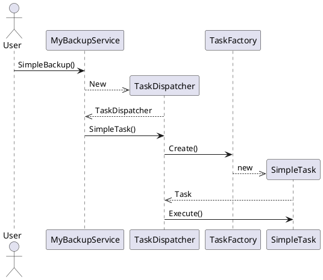

# Case E064

Diagram type: sequence · tier 1 · outcome: compile fail
Image: `E064.png`

## Ground truth



## Answer (12 display-only lines removed; they are in `E064.stripped.txt`)

```plantuml
@startuml

actor User
participant MyBackupService
participant TaskDispatcher
participant TaskFactory
participant SimpleTask

User -> MyBackupService : SimpleBackup()
MyBackupService ..> TaskDispatcher : New
TaskDispatcher ..> MyBackupService : TaskDispatcher
MyBackupService -> TaskDispatcher : SimpleTask()
TaskDispatcher -> TaskFactory : Create()
TaskFactory ..> SimpleTask : new
SimpleTask ..> TaskDispatcher : Task
TaskDispatcher -> SimpleTask : Execute()

@enduml
```

## Renderer

Renderer: error at line 22 of the answer block: `MyBackupService ..> TaskDispatcher : New`
