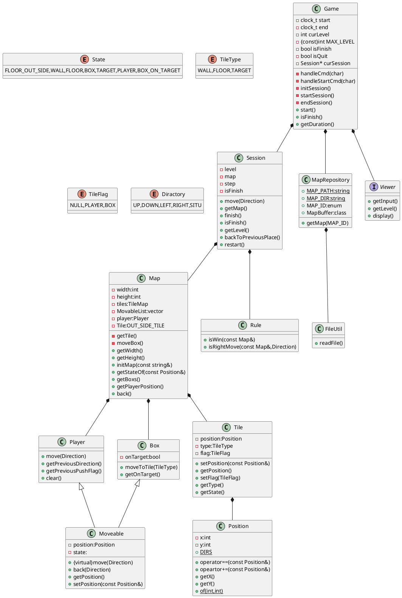
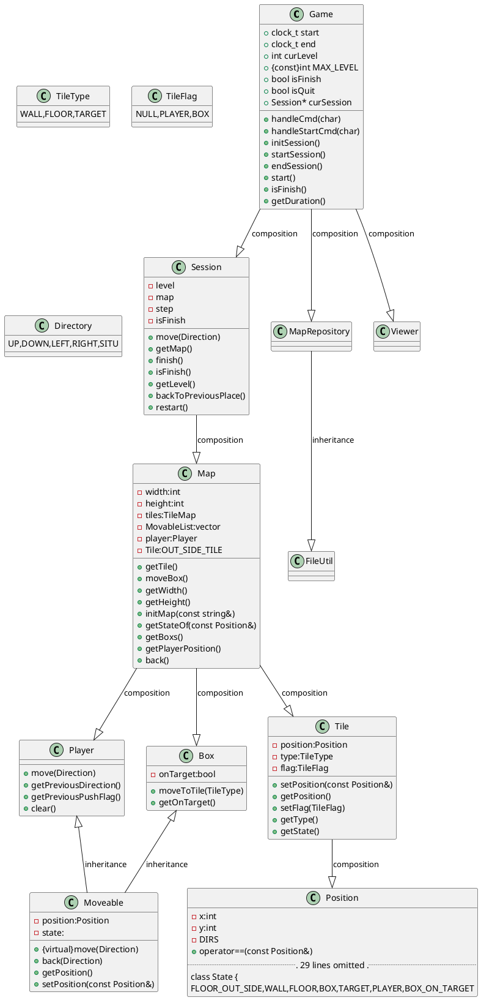

# Case E066

Diagram type: class · tier 4 · outcome: compiled low-structural
Image: `E066.png`

## Ground truth

## Answer (2 display-only lines removed; they are in `E066.stripped.txt`)

## Structural diff

Element F1 0.938 · Relationship F1 0.174

- nodes matched (15): `box`, `fileutil`, `game`, `map`, `maprepository`, `moveable`, `player`, `position`, `rule`, `session`, `state`, `tile`, `tileflag`, `tiletype`, `viewer`
- nodes missed (1): `diractory`
- nodes spurious (1): `directory`
- edges matched (2): `moveable -> box : inheritance`, `moveable -> player : inheritance`
- edges missed (10): `game -> maprepository : composition`, `game -> session : composition`, `game -> viewer : composition`, `map -> box : composition`, `map -> player : composition`, `map -> tile : composition`, `maprepository -> fileutil : composition`, `session -> map : composition`, `session -> rule : composition`, `tile -> position : composition`
- edges spurious (9): `game -> maprepository : inheritance`, `game -> session : inheritance`, `game -> viewer : inheritance`, `map -> box : inheritance`, `map -> player : inheritance`, `map -> tile : inheritance`, `maprepository -> fileutil : inheritance`, `session -> map : inheritance`, `tile -> position : inheritance`
