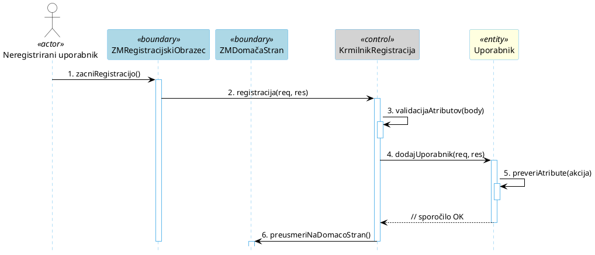

# Case E067

Diagram type: sequence · tier 3 · outcome: compile fail
Image: `E067.png`

## Ground truth



## Answer (3 display-only lines removed; they are in `E067.stripped.txt`)

```plantuml
@startuml

actor "" as User
participant "<<boundary>>\nZMRegistracijskiObrazec" as ZMRegistracijskiObrazec <<boundary>> #LightBlue
participant "<<boundary>>\nZMDomačaStran" as ZMDomačaStran <<boundary>> #LightBlue
participant "<<control>>\nKrmilnikRegistracija" as KrmilnikRegistracija <<control>> #LightGray
participant "<<entity>>\nUporabnik" as Uporabnik <<entity>> #LightYellow

User -> ZMRegistracijskiObrazec : vnesiPodatke(ime, priimek, email, geslo)
activate ZMRegistracijskiObrazec

ZMRegistracijskiObrazec -> KrmilnikRegistracija : registriraj(ime, priimek, email, geslo)
activate KrmilnikRegistracija

KrmilnikRegistracija -> KrmilnikRegistracija : preveriPodatke()
activate KrmilnikRegistracija
deactivate KrmilnikRegistracija

KrmilnikRegistracija -> Uporabnik : ustvari(ime, priimek, email, geslo)
activate Uporabnik

Uporabnik -> Uporabnik : shrani()
activate Uporabnik
deactivate Uporabnik

Uporabnik --> KrmilnikRegistracija : uspeh
deactivate Uporabnik

KrmilnikRegistracija --> ZMRegistracijskiObrazec : uspeh
deactivate KrmilnikRegistracija

ZMRegistracijskiObrazec -> ZMDomačaStran : prikaži()
activate ZMDomačaStran
deactivate ZMDomačaStran

deactivate ZMRegistracijskiObrazec

@enduml
```

## Renderer

Renderer: error at line 6 of the answer block: `actor "" as User`
