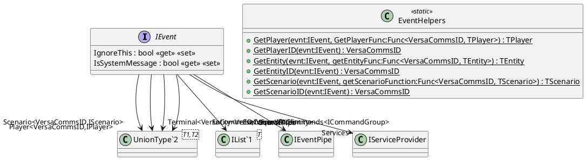
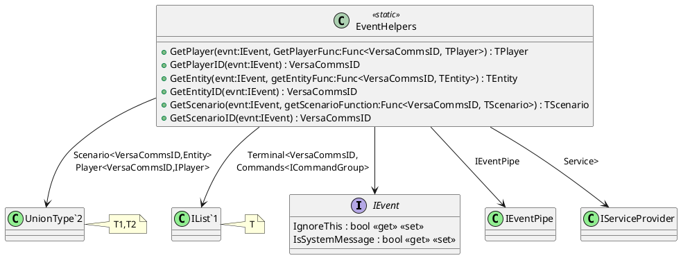

# Case E068

Diagram type: class · tier 2 · outcome: compiled low-structural
Image: `E068.png`

## Ground truth

## Answer (0 display-only lines removed; they are in `E068.stripped.txt`)

## Structural diff

Element F1 0.857 · Relationship F1 0.000

- nodes matched (6): `eventhelpers`, `ievent`, `ieventpipe`, `ilist`1`, `iserviceprovider`, `uniontype`2`
- nodes missed (0): none
- nodes spurious (2): `t`, `t1,t2`
- edges matched (0): none
- edges missed (7): `ievent -> ieventpipe : association (one arrowhead)`, `ievent -> ilist`1 : association (one arrowhead)`, `ievent -> iserviceprovider : association (one arrowhead)`, `ievent -> uniontype`2 : association (one arrowhead)` ×4
- edges spurious (7): `eventhelpers -> ievent : association (one arrowhead)`, `eventhelpers -> ieventpipe : association (one arrowhead)`, `eventhelpers -> ilist`1 : association (one arrowhead)`, `eventhelpers -> iserviceprovider : association (one arrowhead)`, `eventhelpers -> uniontype`2 : association (one arrowhead)`, `ilist`1 -> t : dependency`, `uniontype`2 -> t1,t2 : dependency`
