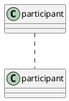

# Case E069

Diagram type: sequence · tier 1 · outcome: compiled low-structural
Image: `E069.png`

## Ground truth

```plantuml
' Blob ID: c22af72a8329b4b5b474e1e7294a3e3d251bf753
' Original Path: /example/teste/arquivo.ts.sequence.puml
' Source: World of Code

@startuml 
 participant participant as Usuario
@enduml
```

## Answer (7 display-only lines removed; they are in `E069.stripped.txt`)

## Structural diff

Element F1 0.667 · Relationship F1 0.000

- nodes matched (1): `participant`
- nodes missed (0): none
- nodes spurious (1): `participant`
- edges matched (0): none
- edges missed (0): none
- edges spurious (1): `participant -> participant : dependency`
