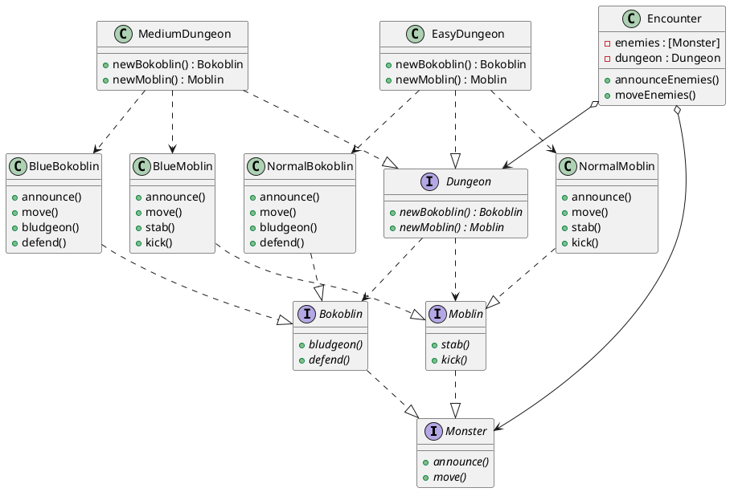
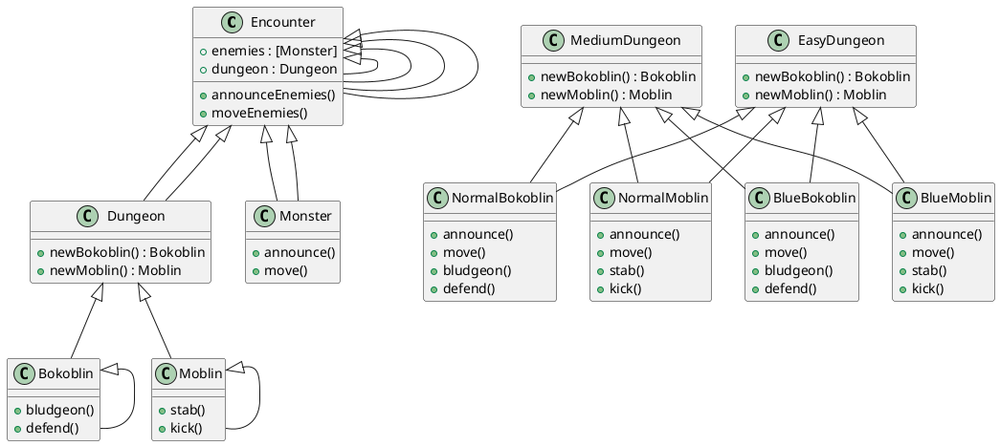

# Case E070

Diagram type: class · tier 4 · outcome: compiled low-structural
Image: `E070.png`

## Ground truth

## Answer (2 display-only lines removed; they are in `E070.stripped.txt`)

## Structural diff

Element F1 1.000 · Relationship F1 0.000

- nodes matched (11): `bluebokoblin`, `bluemoblin`, `bokoblin`, `dungeon`, `easydungeon`, `encounter`, `mediumdungeon`, `moblin`, `monster`, `normalbokoblin`, `normalmoblin`
- nodes missed (0): none
- nodes spurious (0): none
- edges matched (0): none
- edges missed (16): `bluebokoblin -> bokoblin : inheritance`, `bluemoblin -> moblin : inheritance`, `bokoblin -> monster : inheritance`, `dungeon -> bokoblin : dependency`, `dungeon -> moblin : dependency`, `easydungeon -> dungeon : inheritance`, `easydungeon -> normalbokoblin : dependency`, `easydungeon -> normalmoblin : dependency`, `encounter -> dungeon : aggregation`, `encounter -> monster : aggregation`, `mediumdungeon -> bluebokoblin : dependency`, `mediumdungeon -> bluemoblin : dependency`, `mediumdungeon -> dungeon : inheritance`, `moblin -> monster : inheritance`, `normalbokoblin -> bokoblin : inheritance`, `normalmoblin -> moblin : inheritance`
- edges spurious (20): `bluebokoblin -> easydungeon : inheritance`, `bluebokoblin -> mediumdungeon : inheritance`, `bluemoblin -> easydungeon : inheritance`, `bluemoblin -> mediumdungeon : inheritance`, `bokoblin -> bokoblin : inheritance`, `bokoblin -> dungeon : inheritance`, `dungeon -> encounter : inheritance` ×2, `encounter -> encounter : inheritance` ×4, `moblin -> dungeon : inheritance`, `moblin -> moblin : inheritance`, `monster -> encounter : inheritance` ×2, `normalbokoblin -> easydungeon : inheritance`, `normalbokoblin -> mediumdungeon : inheritance`, `normalmoblin -> easydungeon : inheritance`, `normalmoblin -> mediumdungeon : inheritance`
