# Case E071

Diagram type: sequence · tier 1 · outcome: compile fail
Image: `E071.png`

## Ground truth

```plantuml
' Blob ID: c22af72a8329b4b5b474e1e7294a3e3d251bf753
' Original Path: /example/teste/arquivo.ts.sequence.puml
' Source: World of Code

@startuml 
 participant participant as Usuario
@enduml
```



## Answer (0 display-only lines removed; they are in `E071.stripped.txt`)

```plantuml
@startuml
participant participant
participant participant
participant -- participant
@enduml
```

## Renderer

Renderer: error at line 4 of the answer block: `participant -- participant`
