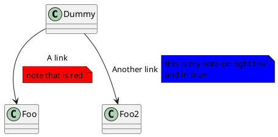

# Case E072

Diagram type: class · tier 1 · outcome: compile fail
Image: `E072.png`

## Ground truth



## Answer (1 display-only lines removed; they are in `E072.stripped.txt`)

```plantuml
@startuml

class Dummy
class Foo
class Foo2

Dummy -down-> Foo : A link
Dummy -down-> Foo2 : Another link

note left of Dummy -[#red,fill=red] 
note that is red
end note

note right of Dummy -[#blue,fill=blue]
this is my note on right link
and in blue
end note
@enduml
```

## Renderer

Renderer: error at line 11 of the answer block: `note left of Dummy -[#red,fill=red]`
