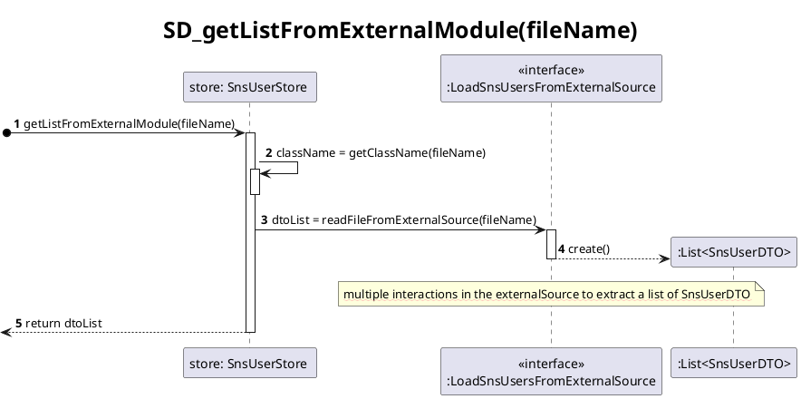

# Case E073

Diagram type: sequence · tier 2 · outcome: compile fail
Image: `E073.png`

## Ground truth



## Answer (5 display-only lines removed; they are in `E073.stripped.txt`)

```plantuml
@startuml


actor " " as caller

participant "store: SnsUserStore" as store
participant "<<interface>>\n:LoadSnsUsersFromExternalSource" as loader
participant ":List<SnsUserDTO>" as list

caller -> store : 1 getListFromExternalModule(fileName)
activate store

store -> store : 2 className = getClassName(fileName)

store -> loader : 3 dtoList = readFileFromExternalSource(fileName)
activate loader

loader ..> list : 4 create()

note over loader, list
multiple interactions in the externalSource to extract a list of SnsUserDTO
end note

deactivate loader

store --> caller : 5 return dtoList
deactivate store

@enduml
```

## Renderer

Renderer: error at line 23 of the answer block: `loader ..> list : 4 create()`
