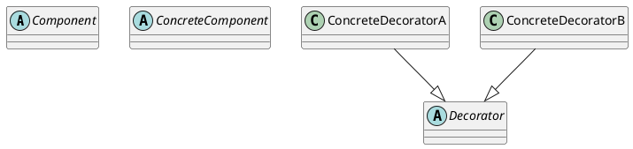

# Case E074

Diagram type: class · tier 2 · outcome: compile fail
Image: `E074.png`

## Ground truth



## Answer (359 display-only lines removed; they are in `E074.stripped.txt`)

```plantuml
@startuml
skin
```

## Renderer

The answer has no `@enduml`. Renderer: no PNG produced
