# Case E075

Diagram type: sequence · tier 4 · outcome: compiled low-structural
Image: `E075.png`

## Ground truth

```plantuml
' Blob ID: a3dcb61f2ecaf6dee5441bd626e8a5edf0decc2c
' Original Path: /diagrams-docs/pm-sequence.puml
' Source: World of Code

@startuml
skinparam noteBorderColor Black
skinparam noteBorderThickness 1
skinparam noteBackgroundColor Yellow
skinparam legendBackgroundColor WhiteSmoke

skinparam sequence {
	BoxBorderColor Black
	BoxFontSize 20

	ArrowColor Black
	ArrowThickness 1

	ActorBorderColor Black
	ActorBorderThickness 3
	ActorBackgroundColor Business
	ActorFontSize 15

	ParticipantBorderColor Black
	ParticipantBorderThickness 1
	ParticipantBackgroundColor Business
	ParticipantFontSize 15

	LifeLineBorderColor Black
	LifeLineBorderThickness 1
	LifeLineBackgroundColor LightGray
}


 legend top right
|= |= Legend |
|<back:LightBlue>   </back>| Control Plane ~ Master Node |
|<back:LightGreen>   </back>| Worker Node |
|<back:DarkGray>   </back>| Power Manager System Setup |
|<back:LightYellow>   </back>| Power Manager Configuration |
|<back:Orange>   </back>| Power Manager Deployment |
endlegend 

actor Georgina
participant apiSrv as "<b>API-Server" #LightBlue
participant etcd as "<b>etcd" #LightBlue
participant cntrlMgr as "<b>Controller Manager" #LightBlue
participant sched as "<b>Scheduler" #LightBlue
participant powerOperator as "<b>Power Operator" #LightBlue
participant kubelet as "<b>Kubelet" #LightGreen
participant agent as "<b>Power Node Agent" #LightGreen
participant library as "<b>Power Optimization Library" #LightGreen
participant objects as "<b>K8s Objects" #LightGreen
participant proxy as "<b>Kube-Proxy" #LightGreen

title : Interactions between the Control Plane (master node) and the Worker Node

== Kubernetes Initialization ==
autonumber

Georgina->>apiSrv: kubectl create -f pod.yaml
apiSrv-->>etcd: save new state
cntrlMgr->>apiSrv: check for changes
sched->>apiSrv: watch for unassigned pods(s)
apiSrv->>sched: notify about pod w nodename=" "
sched->>apiSrv: assign pod to node
apiSrv-->>etcd: save new state
kubelet->>apiSrv: look for newly assigned pod(s)
apiSrv->>kubelet: bind pod to node
kubelet->>agent: start container
kubelet->>apiSrv: update pod status
apiSrv-->>etcd: save new state

autonumber stop


== Power Manager Initialization ==
autonumber

Georgina -> proxy : Ensure correct proxy configuration 

Georgina -> kubelet: Confirm CPU Manager policy
note right #DarkGray: <color #White>cpuManagerPolicy = "static"</color>

Georgina -> kubelet: Reserve System CPUs
note right #DarkGray: <color #White>reservedSystemCPUs = "0"</color>

kubelet -> agent: Create Namespace
note right #LightYellow: <color #black>apply config/rbac/namespace.yaml</color>

kubelet -> agent: Create RBAC and Service Accounts
note right #LightYellow: <color #black>apply config/rbac/rbac.yaml</color>

kubelet -> objects: Create CRDs
note right #LightYellow: <color #black>make</color>

kubelet -> agent: Label nodes
note right #LightYellow: <color #black>label node <NODE_NAME> feature.node.kubernetes.io/power-node=”true”</color>

autonumber stop


== Power Manager Deployment ==
autonumber

kubelet -> agent: Deploy Controller Manager
note right #Orange: <color #black>apply config/manager/manager.yaml</color>

powerOperator -> library: Deploy the config
note right #Orange: <color #black>examples/example-powerconfig.yaml</color>

agent -> library: Set Shared Profile 
note right #Orange: <color #black>examples/example-shared-profile.yaml</color>

agent -> library: Deploy th Workload
note right #Orange: <color #black>examples/example-shared-workload.yaml</color>

agent -> library: Deploy Pod 
note right #Orange: <color #black>examples/example-pod.yaml</color>

autonumber stop

== Power Manager additional functionality ==

== Uncore ==
autonumber

Georgina -> kubelet: Confirm Kernel verson
note right #DarkGray: <color #black>kernel 5.6+ required for uncore</color>


kubelet -> library: Set Freq in Die and Pkg 
note right #Orange: <color #black>examples/example-uncore</color>

kubelet -> agent: Deploy Controller Manager
note right #Orange: <color #black>apply config/manager/manager.yaml</color>

powerOperator -> library: Deploy the config
note right #Orange: <color #black>examples/example-powerconfig.yaml</color>

agent -> library: Set Shared Profile 
note right #Orange: <color #black>examples/example-shared-profile.yaml</color>

agent -> library: Deploy th Workload
note right #Orange: <color #black>examples/example-shared-workload.yaml</color>

agent -> library: Deploy Pod 
note right #Orange: <color #black>examples/example-pod.yaml</color>

agent -> library: Set Time of Day functionality 
note right #Orange: <color #black>examples/example-timeofday</color>

autonumber stop

== P-State ==
autonumber

kubelet -> agent: Deploy Controller Manager
note right #Orange: <color #black>apply config/manager/manager.yaml</color>

powerOperator -> library: Deploy the config
note right #Orange: <color #black>examples/example-powerconfig.yaml</color>

agent -> library: Set Shared Profile \nand configure the P-State governor
note right #Orange: <color #black>examples/example-shared-profile.yaml</color>

agent -> library: Deploy th Workload
note right #Orange: <color #black>examples/example-shared-workload.yaml</color>

agent -> library: Deploy Pod 
note right #Orange: <color #black>examples/example-pod.yaml</color>

autonumber stop

== C-State ==
kubelet -> agent: Deploy Controller Manager
note right #Orange: <color #black>apply config/manager/manager.yaml</color>

powerOperator -> library: Deploy the config
note right #Orange: <color #black>examples/example-powerconfig.yaml</color>

agent -> library: Set Shared Profile 
note right #Orange: <color #black>examples/example-shared-profile.yaml</color>

agent -> library: Deploy th Workload
note right #Orange: <color #black>examples/example-shared-workload.yaml</color>

agent -> library: Deploy Pod 
note right #Orange: <color #black>examples/example-pod.yaml</color>

agent -> library: Set C-State functionality 
note right #Orange: <color #black>examples/example-cstates</color>

== Time of Day ==

kubelet -> agent: Deploy Controller Manager
note right #Orange: <color #black>apply config/manager/manager.yaml</color>

powerOperator -> library: Deploy the config
note right #Orange: <color #black>examples/example-powerconfig.yaml</color>

agent -> library: Set Shared Profile 
note right #Orange: <color #black>examples/example-shared-profile.yaml</color>

agent -> library: Deploy th Workload
note right #Orange: <color #black>examples/example-shared-workload.yaml</color>

agent -> library: Deploy Pod 
note right #Orange: <color #black>examples/example-pod.yaml</color>

agent -> library: Set Time of Day functionality 
note right #Orange: <color #black>examples/example-timeofday</color>


@enduml
```

## Answer (1 display-only lines removed; they are in `E075.stripped.txt`)

```plantuml
@startuml

legend top right
  | Legend |
  |<#LightBlue> Control Plane ~ Master Node |
  |<#LightGreen> Worker Node |
  |<#LightGray> Power Manager System Setup |
  |<#White> Power Manager Configuration |
  |<#Orange> Power Manager Deployment |
endlegend

actor Georgina
participant "API-Server" as API #LightBlue
participant "etcd" as etcd #LightBlue
participant "Controller Manager" as CM #LightBlue
participant "Scheduler" as Sched #LightBlue
participant "Power Operator" as PO #LightBlue
participant "Kubelet" as Kubelet #LightGreen
participant "Power Node Agent" as PNA #LightGreen
participant "Power Optimization Library" as POL #LightGreen
participant "K8s Objects" as K8s #LightGreen
participant "Kube-Proxy" as KP #LightGreen

== Kubernetes Initialization ==
Georgina -> API : 1 kubectl create -f pod.yaml
API --> etcd : 2 save new state
etcd --> API : 3 check for changes
API -> Sched : 4 watch for unassigned pods(s)
Sched -> API : 5 notify about pod w nodename=""
API -> CM : 6 assign pod to node
CM --> etcd : 7 save new state
etcd --> API : 8 look for newly assigned pod(s)
API -> Kubelet : 9 bind pod to node
Kubelet -> PNA : 10 start container
PNA -> Kubelet : 11 update pod status
Kubelet --> etcd : 12 save new state

== Power Manager Initialization ==
Georgina -> KP : 1 Ensure correct proxy configuration
Georgina -> Kubelet : 2 Confirm CPU Manager policy
note right of Kubelet #LightGray: cpuManagerPolicy = "static"
Georgina -> Kubelet : 3 Reserve System CPUs
note right of Kubelet #LightGray: reservedSystemCPUs = "0"
Kubelet -> PNA : 4 Create Namespace
note right of PNA #White: apply config/rbac/namespace.yaml
Kubelet -> PNA : 5 Create RBAC and Service Accounts
note right of PNA #White: apply config/rbac/rbac.yaml
Kubelet -> K8s : 6 Create CRDs
note right of K8s #White: make
Kubelet -> PNA : 7 Label nodes
note right of PNA #White: label node <NODE_NAME> feature.node.kubernetes.io/power-node="true"

== Power Manager Deployment ==
Kubelet -> PNA : 1 Deploy Controller Manager
note right of PNA #Orange: apply config/manager/manager.yaml
Kubelet -> POL : 2 Deploy the config
note right of POL #Orange: examples/example-powerconfig.yaml
POL -> POL : 3 Set Shared Profile
note right of POL #Orange: examples/example-shared-profile.yaml
POL -> POL : 4 Deploy th Workload
note right of POL #Orange: examples/example-shared-workload.yaml
POL -> POL : 5 Deploy Pod
note right of POL #Orange: examples/example-pod.yaml

== Power Manager additional functionality ==
=== Uncore ===
Georgina -> Kubelet : 1 Confirm Kernel version
note right of Kubelet #LightGray: kernel 5.6+ required for uncore
Kubelet -> POL : 2 Set Freq in Die and Pkg
note right of POL #Orange: examples/example-uncore
Kubelet -> PNA : 3 Deploy Controller Manager
note right of PNA #Orange: apply config/manager/manager.yaml
Kubelet -> POL : 4 Deploy the config
note right of POL #Orange: examples/example-powerconfig.yaml
POL -> POL : 5 Set Shared Profile
note right of POL #Orange: examples/example-shared-profile.yaml
POL -> POL : 6 Deploy th Workload
note right of POL #Orange: examples/example-shared-workload.yaml
POL -> POL : 7 Deploy Pod
note right of POL #Orange: examples/example-pod.yaml
POL -> POL : 8 Set Time of Day functionality
note right of POL #Orange: examples/example-timeofday

=== P-State ===
Kubelet -> PNA : 1 Deploy Controller Manager
note right of PNA #Orange: apply config/manager/manager.yaml
Kubelet -> POL : 2 Deploy the config
note right of POL #Orange: examples/example-powerconfig.yaml
POL -> POL : 3 Set Shared Profile\nand configure the P-State governor
note right of POL #Orange: examples/example-shared-profile.yaml
... 4 lines omitted ...

=== C-State ===
Kubelet -> PNA : Deploy Controller Manager
note right of PNA #Orange: apply config/manager/manager.yaml
Kubelet -> POL : Deploy the config
note right of POL #Orange: examples/example-powerconfig.yaml
POL -> POL : Set Shared Profile
note right of POL #Orange: examples/example-shared-profile.yaml
POL -> POL : Deploy th Workload
note right of POL #Orange: examples/example-shared-workload.yaml
POL -> POL : Deploy Pod
note right of POL #Orange: examples/example-pod.yaml
POL -> POL : Set C-State functionality
note right of POL #Orange: examples/example-cstates

=== Time of Day ===
Kubelet -> PNA : Deploy Controller Manager
note right of PNA #Orange: apply config/manager/manager.yaml
Kubelet -> POL : Deploy the config
note right of POL #Orange: examples/example-powerconfig.yaml
POL -> POL : Set Shared Profile
note right of POL #Orange: examples/example-shared-profile.yaml
POL -> POL : Deploy th Workload
note right of POL #Orange: examples/example-shared-workload.yaml
POL -> POL : Deploy Pod
note right of POL #Orange: examples/example-pod.yaml
POL -> POL : Set Time of Day functionality
note right of POL #Orange: examples/example-timeofday

@enduml
```

## Structural diff

Element F1 1.000 · Relationship F1 0.408

- nodes matched (11): `api-server`, `controller manager`, `etcd`, `georgina`, `k8s objects`, `kube-proxy`, `kubelet`, `power node agent`, `power operator`, `power optimization library`, `scheduler`
- nodes missed (0): none
- nodes spurious (0): none
- edges matched (20): `api-server -> etcd : message`, `api-server -> kubelet : message`, `api-server -> scheduler : message`, `georgina -> api-server : message`, `georgina -> kube-proxy : message`, `georgina -> kubelet : message` ×3, `kubelet -> k8s objects : message`, `kubelet -> power node agent : message` ×9, `kubelet -> power optimization library : message`, `scheduler -> api-server : message`
- edges missed (29): `api-server -> etcd : message` ×2, `controller manager -> api-server : message`, `kubelet -> api-server : message` ×2, `power node agent -> power optimization library : message` ×18, `power operator -> power optimization library : message` ×5, `scheduler -> api-server : message`
- edges spurious (29): `api-server -> controller manager : message`, `controller manager -> etcd : message`, `etcd -> api-server : message` ×2, `kubelet -> etcd : message`, `kubelet -> power optimization library : message` ×5, `power node agent -> kubelet : message`, `power optimization library -> power optimization library : message` ×18
