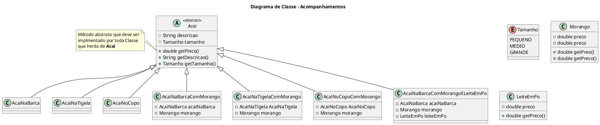

# Case E076

Diagram type: class · tier 4 · outcome: compile fail
Image: `E076.png`

## Ground truth



## Answer (4 display-only lines removed; they are in `E076.stripped.txt`)

```plantuml
@startuml


note left of Acai
Método abstrato que deve ser
implementado por toda Classe
que herda de Acai
end note

abstract class Acai <<abstract>> {
  String descricao
  Tamanho tamanho
  {abstract} double getPreco()
  String getDescricao()
  Tamanho getTamanho()
}

enum Tamanho {
  PEQUENO
  MEDIO
  GRANDE
}

class AcaiNaBarca
class AcaiNaTigela
class AcaiNoCopo

class Morango {
  double preco
  double preco
  double getPre()
  double getPreco()
}

class LeiteEmPo {
  double preco
  double getPreco()
}

class AcaiNaBarcaComMorango {
  AcaiNaBarca acaiNaBarca
  Morango morango
}

class AcaiNaTigelaComMorango {
  AcaiNaTigela AcaiNaTigela
  Morango morango
}

class AcaiNoCopoComMorango {
  AcaiNoCopo AcaiNoCopo
  Morango morango
}

class AcaiNaBarcaComMorangoELeiteEmPo {
  AcaiNaBarca acaiNaBarca
  Morango morango
  LeiteEmPo leiteEmPo
}

AcaiNaBarca --|> Acai
AcaiNaTigela --|> Acai
AcaiNoCopo --|> Acai

AcaiNaBarcaComMorango --|> Acai
AcaiNaTigelaComMorango --|> Acai
AcaiNoCopoComMorango --|> Acai
AcaiNaBarcaComMorangoELeiteEmPo --|> Acai

AcaiNaBarcaComMorango --> AcaiNaBarca
AcaiNaBarcaComMorango --> Morango

AcaiNaTigelaComMorango --> AcaiNaTigela
AcaiNaTigelaComMorango --> Morango

AcaiNoCopoComMorango --> AcaiNoCopo
AcaiNoCopoComMorango --> Morango

AcaiNaBarcaComMorangoELeiteEmPo --> AcaiNaBarca
AcaiNaBarcaComMorangoELeiteEmPo --> Morango
AcaiNaBarcaComMorangoELeiteEmPo --> LeiteEmPo
@enduml
```

## Renderer

Renderer: error at line 14 of the answer block: `abstract class Acai <<abstract>> {`
