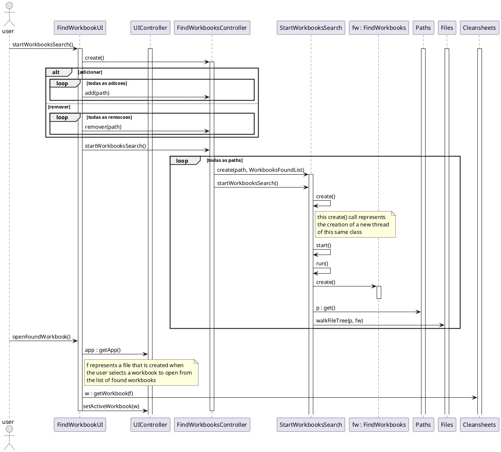
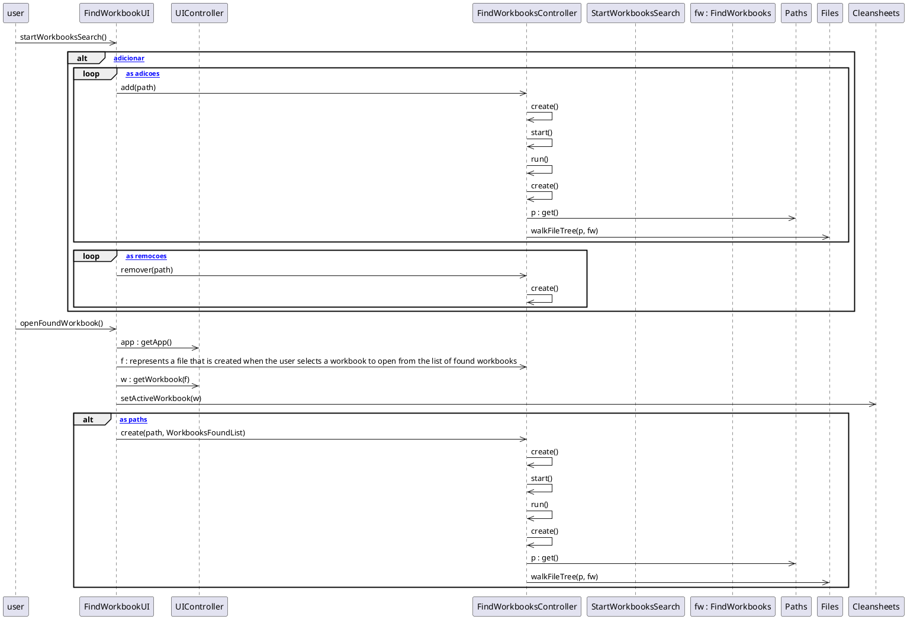

# Case E077

Diagram type: sequence · tier 4 · outcome: compiled low-structural
Image: `E077.png`

## Ground truth

## Answer (0 display-only lines removed; they are in `E077.stripped.txt`)

## Structural diff

Element F1 1.000 · Relationship F1 0.462

- nodes matched (9): `cleansheets`, `files`, `findworkbookscontroller`, `findworkbookui`, `fw : findworkbooks`, `paths`, `startworkbookssearch`, `uicontroller`, `user`
- nodes missed (0): none
- nodes spurious (0): none
- edges matched (9): `findworkbookui -> cleansheets : message`, `findworkbookui -> findworkbookscontroller : message` ×4, `findworkbookui -> uicontroller : message` ×2, `user -> findworkbookui : message` ×2
- edges missed (8): `findworkbookscontroller -> startworkbookssearch : message` ×2, `startworkbookssearch -> files : message`, `startworkbookssearch -> fw : findworkbooks : message`, `startworkbookssearch -> paths : message`, `startworkbookssearch -> startworkbookssearch : message` ×3
- edges spurious (13): `findworkbookscontroller -> files : message` ×2, `findworkbookscontroller -> findworkbookscontroller : message` ×9, `findworkbookscontroller -> paths : message` ×2
