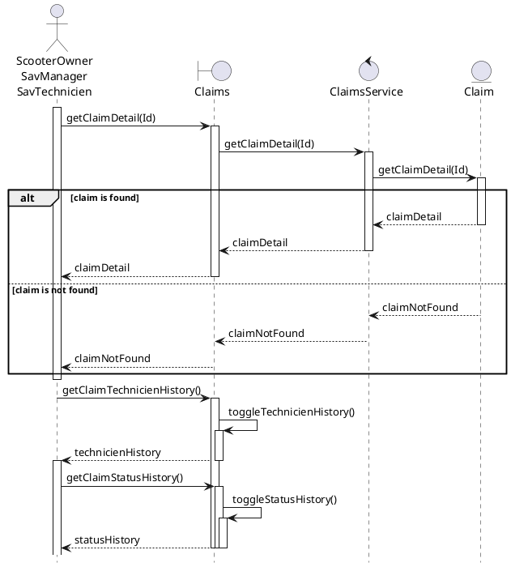

# Case E078

Diagram type: sequence · tier 4 · outcome: compile fail
Image: `E078.png`

## Ground truth



## Answer (0 display-only lines removed; they are in `E078.stripped.txt`)

```plantuml
@startuml
participant as ScooterOwner as "ScooterOwner"
participant as SavManager as "SavManager"
participant as SavTechnicien as "SavTechnicien"
participant as Claims as "Claims"
participant as ClaimsService as "ClaimsService"
participant as Claim as "Claim"

participant as ScooterOwner as "ScooterOwner"
participant as SavManager as "SavManager"
participant as SavTechnicien as "SavTechnicien"
participant as Claims as "Claims"
participant as ClaimsService as "ClaimsService"
participant as Claim as "Claim"

ScooterOwner -> Claims: getClaimDetail(Id)
Claims -> ClaimsService: getClaimDetail(Id)
ClaimsService -> Claim: getClaimDetail(Id)
Claim -> ClaimsService: claimDetail
ClaimsService -> Claims: claimDetail
Claims -> ScooterOwner: claimDetail

[claim is found]
Claims -> ClaimsService: claimNotFound
ClaimsService -> Claim: claimNotFound
Claim -> ClaimsService: claimNotFound
ClaimsService -> Claims: claimNotFound
Claims -> ScooterOwner: claimNotFound

ScooterOwner -> Claims: getClaimTechnicienHistory()
Claims -> ClaimsService: toggleTechnicienHistory()
ClaimsService -> Claims: technicienHistory
Claims -> ScooterOwner: technicienHistory

ScooterOwner -> Claims: getClaimStatusHistory()
Claims -> ClaimsService: toggleStatusHistory()
ClaimsService -> Claims: statusHistory
Claims -> ScooterOwner: statusHistory

@enduml
```

## Renderer

Renderer: error at line 2 of the answer block: `participant as ScooterOwner as "ScooterOwner"`
