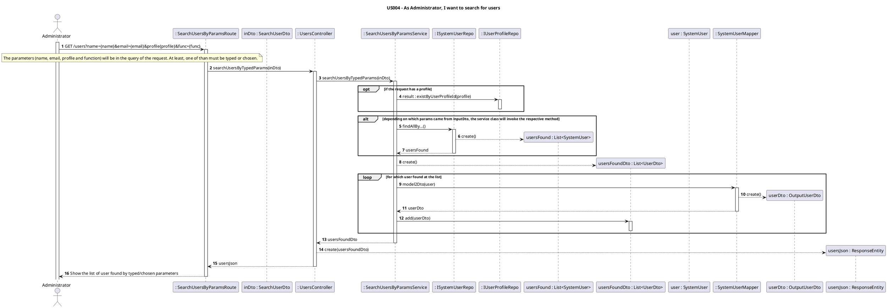
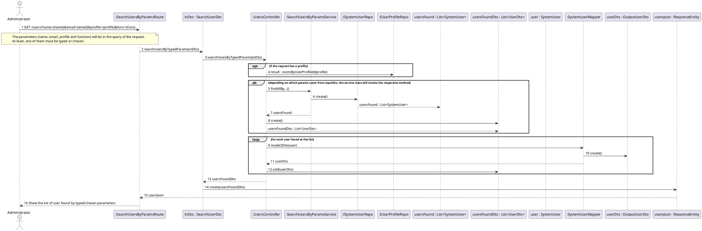

# Case E079

Diagram type: sequence · tier 4 · outcome: compiled low-structural
Image: `E079.png`

## Ground truth

## Answer (1 display-only lines removed; they are in `E079.stripped.txt`)

## Structural diff

Element F1 0.538 · Relationship F1 0.000

- nodes matched (7): `administrator`, `indto : searchuserdto`, `user : systemuser`, `userdto : outputuserdto`, `usersfound : list<systemuser>`, `usersfounddto : list<userdto>`, `usersjson : responseentity`
- nodes missed (6): `: isystemuserrepo`, `: iuserprofilerepo`, `: searchusersbyparamsroute`, `: searchusersbyparamsservice`, `: systemusermapper`, `: userscontroller`
- nodes spurious (6): `:isystemuserrepo`, `:iuserprofilerepo`, `:searchusersbyparamsroute`, `:searchusersbyparamsservice`, `:systemusermapper`, `:userscontroller`
- edges matched (0): none
- edges missed (16): `: isystemuserrepo -> : searchusersbyparamsservice : message`, `: isystemuserrepo -> usersfound : list<systemuser> : message`, `: searchusersbyparamsroute -> : userscontroller : message`, `: searchusersbyparamsroute -> administrator : message`, `: searchusersbyparamsservice -> : isystemuserrepo : message`, `: searchusersbyparamsservice -> : iuserprofilerepo : message`, `: searchusersbyparamsservice -> : systemusermapper : message`, `: searchusersbyparamsservice -> : userscontroller : message`, `: searchusersbyparamsservice -> usersfounddto : list<userdto> : message` ×2, `: systemusermapper -> : searchusersbyparamsservice : message`, `: systemusermapper -> userdto : outputuserdto : message`, `: userscontroller -> : searchusersbyparamsroute : message`, `: userscontroller -> : searchusersbyparamsservice : message`, `: userscontroller -> usersjson : responseentity : message`, `administrator -> : searchusersbyparamsroute : message`
- edges spurious (18): `:isystemuserrepo -> usersfound : list<systemuser> : message`, `:searchusersbyparamsroute -> administrator : message`, `:searchusersbyparamsroute -> indto : searchuserdto : message`, `:searchusersbyparamsservice -> :isystemuserrepo : message`, `:searchusersbyparamsservice -> :userscontroller : message`, `:systemusermapper -> :userscontroller : message`, `:systemusermapper -> userdto : outputuserdto : message`, `:userscontroller -> :iuserprofilerepo : message`, `:userscontroller -> :searchusersbyparamsservice : message`, `:userscontroller -> :systemusermapper : message`, `:userscontroller -> indto : searchuserdto : message`, `:userscontroller -> usersfounddto : list<userdto> : message` ×3, `administrator -> :searchusersbyparamsroute : message`, `indto : searchuserdto -> :userscontroller : message`, `indto : searchuserdto -> usersjson : responseentity : message`, `usersjson : responseentity -> :searchusersbyparamsroute : message`
