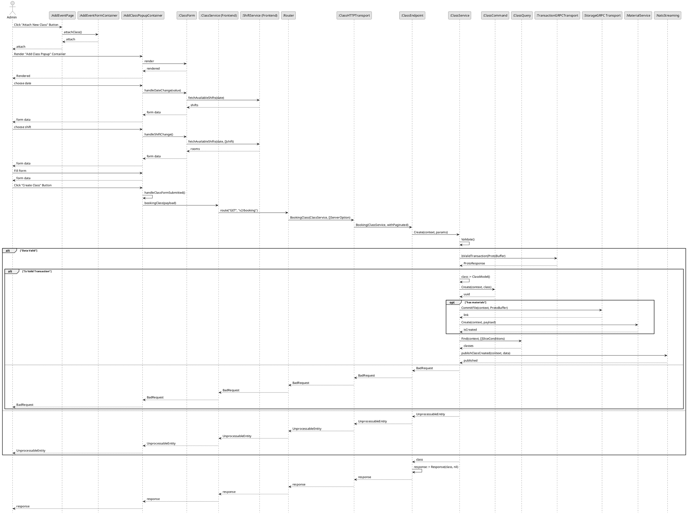
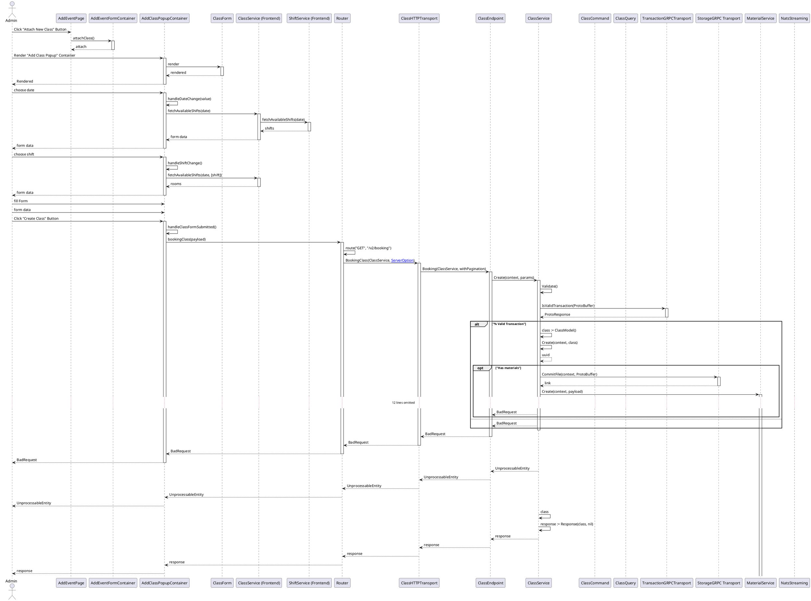

# Case E080

Diagram type: sequence · tier 4 · outcome: compiled low-structural
Image: `E080.png`

## Ground truth

## Answer (1 display-only lines removed; they are in `E080.stripped.txt`)

## Structural diff

Element F1 0.059 · Relationship F1 0.000

- nodes matched (1): `admin`
- nodes missed (16): `:addclasspopupcontainer`, `:addeventformcontainer`, `:addeventpage`, `:classcommand`, `:classendpoint`, `:classform`, `:classhttptransport`, `:classquery`, `:classservice`, `:classservice (frontend)`, `:materialservice`, `:natsstreaming`, `:router`, `:shiftservice (frontend)`, `:storagegrpc transport`, `:transactiongrpctransport`
- nodes spurious (16): `addclasspopupcontainer`, `addeventformcontainer`, `addeventpage`, `classcommand`, `classendpoint`, `classform`, `classhttptransport`, `classquery`, `classservice`, `classservice (frontend)`, `materialservice`, `natsstreaming`, `router`, `shiftservice (frontend)`, `storagegrpc transport`, `transactiongrpctransport`
- edges matched (0): none
- edges missed (62): `:addclasspopupcontainer -> :addclasspopupcontainer : message`, `:addclasspopupcontainer -> :classform : message` ×3, `:addclasspopupcontainer -> :classservice (frontend) : message`, `:addclasspopupcontainer -> admin : message` ×7, `:addeventformcontainer -> :addeventpage : message`, `:addeventpage -> :addeventformcontainer : message`, `:addeventpage -> admin : message`, `:classcommand -> :classservice : message`, `:classendpoint -> :classendpoint : message`, `:classendpoint -> :classhttptransport : message` ×3, `:classendpoint -> :classservice : message`, `:classform -> :addclasspopupcontainer : message` ×3, `:classform -> :shiftservice (frontend) : message` ×2, `:classhttptransport -> :classendpoint : message`, `:classhttptransport -> :router : message` ×3, `:classquery -> :classservice : message`, `:classservice (frontend) -> :addclasspopupcontainer : message` ×3, `:classservice (frontend) -> :router : message`, `:classservice -> :classcommand : message`, `:classservice -> :classendpoint : message` ×3, `:classservice -> :classquery : message`, `:classservice -> :classservice : message` ×2, `:classservice -> :materialservice : message`, `:classservice -> :natsstreaming : message`, `:classservice -> :storagegrpc transport : message`, `:classservice -> :transactiongrpctransport : message`, `:materialservice -> :classservice : message`, `:natsstreaming -> :classservice : message`, `:router -> :classhttptransport : message`, `:router -> :classservice (frontend) : message` ×3, `:shiftservice (frontend) -> :classform : message` ×2, `:storagegrpc transport -> :classservice : message`, `:transactiongrpctransport -> :classservice : message`, `admin -> :addclasspopupcontainer : message` ×5, `admin -> :addeventpage : message`
- edges spurious (60): `addclasspopupcontainer -> addclasspopupcontainer : message` ×3, `addclasspopupcontainer -> admin : message` ×6, `addclasspopupcontainer -> classform : message`, `addclasspopupcontainer -> classservice (frontend) : message` ×2, `addclasspopupcontainer -> router : message`, `addeventformcontainer -> addeventpage : message`, `addeventpage -> addeventformcontainer : message`, `admin -> addclasspopupcontainer : message` ×6, `admin -> addeventpage : message`, `classendpoint -> classhttptransport : message` ×3, `classendpoint -> classservice : message`, `classform -> addclasspopupcontainer : message`, `classhttptransport -> classendpoint : message`, `classhttptransport -> router : message` ×3, `classquery -> classservice : message`, `classservice (frontend) -> addclasspopupcontainer : message` ×2, `classservice (frontend) -> shiftservice (frontend) : message`, `classservice -> classendpoint : message` ×4, `classservice -> classquery : message`, `classservice -> classservice : message` ×6, `classservice -> materialservice : message`, `classservice -> natsstreaming : message`, `classservice -> storagegrpc transport : message`, `classservice -> transactiongrpctransport : message`, `materialservice -> classservice : message`, `natsstreaming -> classservice : message`, `router -> addclasspopupcontainer : message` ×3, `router -> classhttptransport : message`, `router -> router : message`, `shiftservice (frontend) -> classservice (frontend) : message`, `storagegrpc transport -> classservice : message`, `transactiongrpctransport -> classservice : message`
