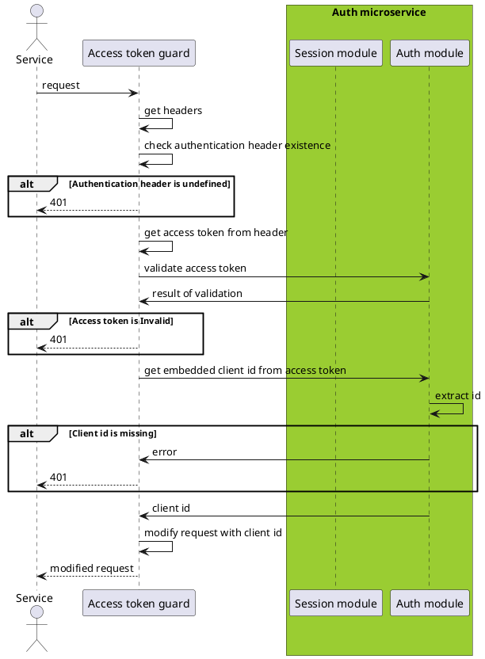

# Case E081

Diagram type: sequence · tier 3 · outcome: compile fail
Image: `E081.png`

## Ground truth



## Answer (1 display-only lines removed; they are in `E081.stripped.txt`)

```plantuml
@startuml
actor "Service" as service
participant "Access token guard" as guard
participant "Auth microservice" as auth
participant "Session module" as session
participant "Auth module" as auth_module

auth -> auth : get headers
auth -> auth : check authentication header existence

alt [Authentication header is undefined]
  service <- 401 : 
end

auth -> auth : get access token from header
auth -> auth_module : validate access token
auth_module -> auth : result of validation

alt [Access token is Invalid]
  service <- 401 : 
end

auth -> auth_module : get embedded client id from access token
auth_module -> auth_module : extract id

alt [Client id is missing]
  auth_module -> auth : error
  service <- 401 : 
end

auth <- client id : 
auth -> auth : modify request with client id
service <- modified request : 

@enduml
```

## Renderer

Renderer: error at line 4 of the answer block: `participant "Access token guard" as guard`
