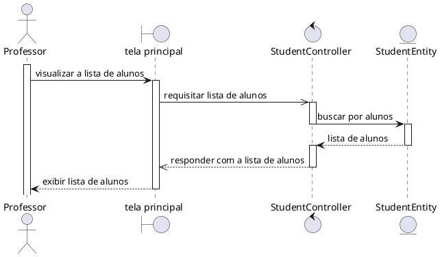

# Case E082

Diagram type: sequence · tier 2 · outcome: compile fail
Image: `E082.png`

## Ground truth



## Answer (0 display-only lines removed; they are in `E082.stripped.txt`)

```plantuml
@startuml
actor Professor
boundary "tela principal" as tela
control StudentController
entity StudentEntity

activate Professor
Professor -> tela : visualizar a lista de alunos
activate tela
tela -> StudentController : requisitar lista de alunos
activate StudentController
StudentController -> StudentEntity : buscar por alunos
activate StudentEntity
StudentEntity --> StudentController : lista de alunos
deactivate StudentEntity
deactivate StudentController
activate StudentController
StudentController --> tela : responder com a lista de alunos
deactivate StudentController
tela --> Professor : exibir lista de alunos
deactivate tela
deactivate Professor
@enduml
```

## Renderer

Renderer: error at line 17 of the answer block: `activate StudentController`
