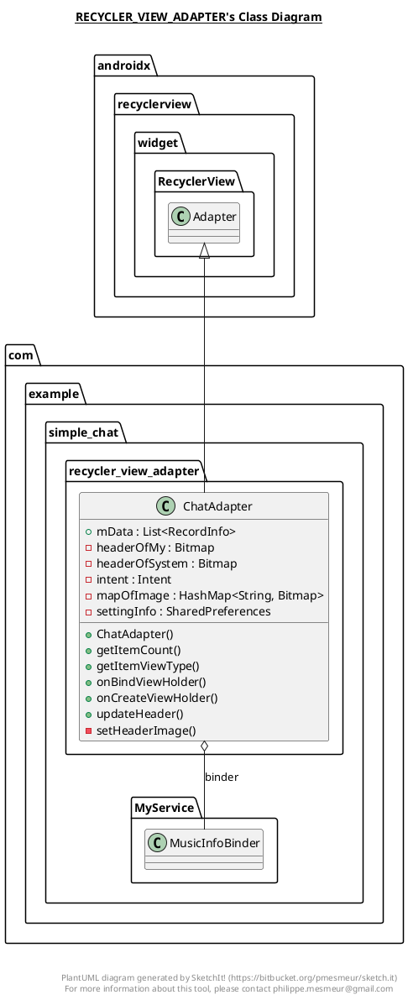
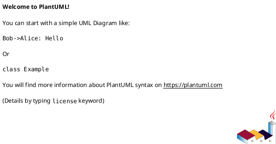

# Case E083

Diagram type: class · tier 3 · outcome: compile fail
Image: `E083.png`

## Ground truth

## Answer (368 display-only lines removed; they are in `E083.stripped.txt`)

## Renderer

The answer has no `@enduml`. Renderer: no PNG produced
