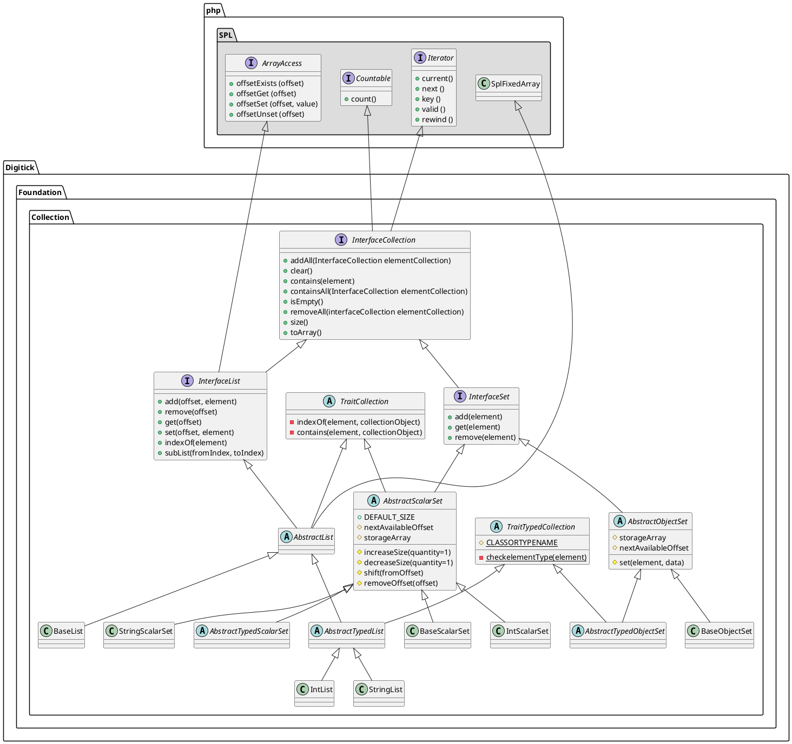

# Case E084

Diagram type: class · tier 4 · outcome: compile fail
Image: `E084.png`

## Ground truth



## Answer (0 display-only lines removed; they are in `E084.stripped.txt`)

```plantuml
@startuml
package SplFixedArray {
    class SplFixedArray {
        +int size
        +int capacity
        +int[] data
        +int[] get(int index)
        +int[] set(int index, int value)
        +int[] get(int index, int value)
        +int[] set(int index, int value, int value)
        +int[] get(int index, int value, int value)
        +int[] set(int index, int value, int value, int value)
        +int[] get(int index, int value, int value, int value)
        +int[] set(int index, int value, int value, int value, int value)
        +int[] get(int index, int value, int value, int value, int value)
        +int[] set(int index, int value, int value, int value, int value, int value)
        +int[] get(int index, int value, int value, int value, int value, int value)
        +int[] set(int index, int value, int value, int value, int value, int value, int value)
        +int[] get(int index, int value, int value, int value, int value, int value, int value, int value)
        +int[] set(int index, int value, int value, int value, int value, int value, int value, int value, int value)
        +int[] get(int index, int value, int value, int value, int value, int value, int value, int value, int value, int value)
        +int[] set(int index, int value, int value, int value, int value, int value, int value, int value, int value, int value, int value)
        +int[] get(int index, int value, int value, int value, int value, int value, int value, int value, int value, int value, int value, int value)
        +int[] set(int index, int value, int value, int value, int value, int value, int value, int value, int value, int value, int value, int value, int value)
        +int[] get(int index, int value, int value, int value, int value, int value, int value, int value, int value, int value, int value, int value, int value, int value)
        +int[] set(int index, int value, int value, int value, int value, int value, int value, int value, int value, int value, int value, int value, int value, int value, int value)
        +int[] get(int index, int value, int value, int value, int value, int value, int value, int value, int value, int value, int value, int value, int value, int value, int value, int value)
        +int[] set(int index, int value, int value, int value, int value, int value, int value, int value, int value, int value, int value, int value, int value, int value, int value, int value, int value)
        +int[] get(int index, int value, int value, int value, int value, int value, int value, int value, int value, int value, int value, int value, int value, int value, int value, int value, int value, int value)
        +int[] set(int index, int value, int value, int value, int value, int value, int value, int value, int value, int value, int value, int value, int value, int value, int value, int value, int value, int value, int value)
        +int[] get(int index, int value, int value, int value, int value, int value, int value, int value, int value, int value, int value, int value, int value, int value, int value, int value, int value, int value, int value, int value)
        +int[] set(int index, int value, int value, int value, int value, int value, int value, int value, int value, int value, int value, int value, int value, int value, int value, int value, int value, int value, int value, int value, int value)
        +int[] get(int index, int value, int value, int value, int value, int value, int value, int value, int value, int value, int value, int value, int value, int value, int value, int value, int value, int value, int value, int value, int value, int value)
        +int[] set(int index, int value, int value, int value, int value, int value, int value, int value, int value, int value, int value, int value, int value, int value, int value, int value, int value, int value, int value, int value, int value, int value, int value)
        +int[] get(int index, int value, int value, int value, int value, int value, int value, int value, int value, int value, int value, int value, int value, int value, int value, int value, int value, int value, int value, int value, int value, int value, int value, int value)
        +int[] set(int index, int value, int value, int value, int value, int value, int value, int value, int value, int value, int value, int value, int value, int value, int value, int value, int value, int value, int value, int value, int value, int value, int value, int value, int value)
        +int[] get(int index, int value, int value, int value, int value, int value, int value, int value, int value, int value, int value, int value, int value, int value, int value, int value, int value, int value, int value, int value, int value, int value, int value, int value, int value, int value)
        +int[] set(int index, int value, int value, int value, int value, int value, int value, int value, int value, int value, int value, int value, int value, int value, int value, int value, int value, int value, int value, int value, int value, int value, int value, int value, int value, int value, int value)
        +int[] get(int index, int value, int value, int value, int value, int value, int value, int value, int value, int value, int value, int value, int value, int value, int value, int value, int value, int value, int value, int value, int value, int value, int value, int value, int value, int value, int value, int value)
        +int[] set(int index, int value, int value, int value, int value, int value, int value, int value, int value, int value, int value, int value, int value, int value, int value, int value, int value, int value, int value, int value, int value, int value, int value, int value, int value, int value, int value, int value, int value)
        +int[] get(int index, int value, int value, int value, int value, int value, int value, int value, int value, int value, int value, int value, int value, int value, int value, int value, int value, int value, int value, int value, int value, int value, int value, int value, int value, int value, int value, int value, int value, int value, int value)
        +int[] set(int index, int value, int value, int value, int value, int value, int value, int value, int value, int value, int value, int value, int value, int value, int value, int value, int value, int value, int value, int value, int value, int value, int value, int value, int value, int value, int value, int value, int value, int value, int value)
        +int[] get(int index, int value, int value, int value, int value, int value, int value, int value, int value, int value, int value, int value, int value, int value, int value, int value, int value, int value, int value, int value, int value, int value, int value, int value, int value, int value, int value, int value, int value, int value, int value, int value)
        +int[] set(int index, int value, int value, int value, int value, int value, int value, int value, int value, int value, int value, int value, int value, int value, int value, int value, int value, int value, int value, int value, int value, int value, int value, int value, int value, int value, int value, int value, int value, int value, int value, int value, int value)
        +int[] get(int index, int value, int value, int value, int value, int value, int value, int value, int value, int value, int value, int value, int value, int value, int value, int value, int value, int value, int value, int value, int value, int value, int value, int value, int value, int value, int value, int value, int value, int value, int value, int value, int value, int value)
        +int[] set(int index, int value, int value, int value, int value, int value, int value, int value, int value, int value, int value, int value, int value, int value, int value, int value, int value, int value, int value, int value, int value, int value, int value, int value, int value, int value, int value, int value, int value, int value, int value, int value, int value, int value)
        +int[] get(int index, int value, int value, int value, int value, int value, int value, int value, int value, int value, int value, int value, int value, int value, int value, int value, int value, int value, int value, int value, int value, int value, int value, int value, int value, int value, int value, int value, int value, int value, int value, int value, int value, int value, int value)
        +int[] set(int index, int value, int value, int value, int value, int value, int value, int value, int value, int value, int value, int value, int value, int value, int value, int value, int value, int value, int value, int value, int value, int value, int value, int value, int value, int value, int value, int value, int value, int value, int value, int value, int value, int value, int value)
        +int[] get(int index, int value, int value, int value, int value, int value, int value, int value, int value, int value, int value, int value, int value, int value, int value, int value, int value, int value, int value, int value, int value, int value, int value, int value, int value, int value, int value, int value, int value, int value, int value, int value, int value, int value, int value, int value)
        +int[] set(int index, int value, int value, int value, int value, int value, int value, int value, int value, int value, int value, int value, int value, int value, int value, int value, int value, int value, int value, int value, int value, int value, int value, int value, int value, int value, int value, int value, int value, int value, int value, int value, int value, int value, int value, int value)
        +int[] get(int index, int value, int value, int value, int value, int value, int value, int value, int value, int value, int value, int value, int value, int value, int value, int value, int value, int value, int value, int value, int value, int value, int value, int value, int value, int value, int value, int value, int value, int value, int value, int value, int value, int value, int value, int value, int value)
        +int[] set(int index, int value, int value, int value, int value, int value, int value, int value, int value, int value, int value, int value, int value, int value, int value, int value, int value, int value, int value, int value, int value, int value, int value, int value, int value, int value, int value, int value, int value, int value, int value, int value, int value, int value, int value, int value, int value)
        +int[] get(int index, int value, int value, int value, int value, int value, int value, int value, int value, int value, int value, int value, int value, int value, int value, int value, int value, int value, int value, int value, int value, int value, int value, int value, int value, int value, int value, int value, int value, int value, int value, int value, int value, int value, int value, int value, int value)
        +int[] set(int index, int value, int value, int value, int value, int value, int value, int value, int value, int value, int value, int value, int value, int value, int value, int value, int value, int value, int value, int value, int value, int value, int value, int value, int value, int value, int value, int value, int value, int value, int value, int value, int value, int value, int value, int value, int value, int value)
        +int[] get(int index, int value, int value, int value, int value, int value, int value, int value, int value, int value, int value, int value, int value, int value, int value, int value, int value, int value, int value, int value, int value, int value, int value, int value, int value, int value, int value, int value, int value, int value, int value, int value, int value, int value, int value, int value, int value, int value)
        +int[] set(int index, int value, int value, int value, int value, int value, int value, int value, int value, int value, int value, int value, int value, int value, int value, int value, int value, int value, int value, int value, int value, int value, int value, int value, int value, int value, int value, int value, int value, int value, int value, int value, int value, int value, int value, int value, int value, int value, int value)
        +int[] get(int index, int value, int value, int value, int value, int value, int value, int value, int value, int value, int value, int value, int value, int value, int value, int value, int value, int value, int value, int value, int value, int value, int value, int value, int value, int value, int value, int value, int value, int value, int value, int value, int value, int value, int value, int value, int value, int value, int value, int value)
        +int[] set(int index, int value, int value, int value, int value, int value, int value, int value, int value, int value, int value, int value, int value, int value, int value, int value, int value, int value, int value, int value, int value, int value, int value, int value, int value, int value, int value, int value, int value, int value, int value, int value, int value, int value, int value, int value, int value, int value, int value, int value, int value, int value)
        +int[] get(int index, int value, int value, int value, int value, int value, int value, int value, int value, int value, int value, int value, int value, int value, int value, int value, int value, int value, int value, int value, int value, int value, int value, int value, int value, int value, int value, int value, int value, int value, int value, int value, int value, int value, int value, int value, int value, int value, int value, int value, int value, int value, int value)
        +int[] set(int index, int value, int value, int value, int value, int value, int value, int value, int value, int value, int value, int value, int value, int value, int value, int value, int value, int value, int value, int value, int value, int value, int value, int value, int value, int value, int value, int value, int value, int value, int value, int value, int value, int value, int value, int value, int value, int value, int value, int value, int value, int value, int value, int value)
        +int[] get(int index, int value, int value, int value, int value, int value, int value, int value, int value, int value, int value, int value, int value, int value, int value, int value, int value, int value, int value, int value, int value, int value, int value, int value, int value, int value, int value, int value, int value, int value, int value, int value, int value, int value, int value, int value, int value, int value, int value, int value, int value, int value, int value, int value, int value)
        +int[] set(int index, int value, int value, int value, int value, int value, int value, int value, int value, int value, int value, int value, int value, int value, int value, int value, int value, int value, int value, int value, int value, int value, int value, int value, int value, int value, int value, int value, int value, int value, int value, int value, int value, int value, int value, int value, int value, int value, int value, int value, int value, int value, int value, int value, int value, int value)
        +int[] get(int index, int value, int value, int value, int value, int value, int value, int value, int value, int value, int value, int value, int value, int value, int value, int value, int value, int value, int value, int value, int value, int value, int value, int value, int value, int value, int value, int value, int value, int value, int value, int value, int value, int value, int value, int value, int value, int value, int value, int value, int value, int value, int value, int value, int value, int value)
        +int[] set(int index, int value, int value, int value, int value, int value, int value, int value, int value, int value, int value, int value, int value, int value, int value, int value, int value, int value, int value, int value, int value, int value, int value, int value, int value, int value, int value, int value, int value, int value, int value, int value, int value, int value, int value, int value, int value, int value, int value, int value, int value, int value, int value, int value, int value, int value, int value)
        +int[] get(int index, int value, int value, int value, int value, int value, int value, int value, int value, int value, int value, int value, int value, int value, int value, int value, int value, int value, int value, int value, int value, int value, int value, int value, int value, int value, int value, int value, int value, int value, int value, int value, int value, int value, int value, int value, int value, int value, int value, int value, int value, int value, int value, int value, int value, int value, int value)
        +int[] set(int index, int value, int value, int value, int value, int value, int value, int value, int value, int value, int value, int value, int value, int value, int value, int value, int value, int value, int value, int value, int value, int value, int value, int value, int value, int value, int value, int value, int value, int value, int value, int value, int value, int value, int value, int value, int value, int value, int value, int value, int value, int value, int value, int value, int value, int value, int value, int value)
        +int[] get(int index, int value, int value, int value, int value, int value, int value, int value, int value, int value, int value, int value, int value, int value, int value, int value, int value, int value, int value, int value, int value, int value, int value, int value, int value, int value, int value, int value, int value, int value, int value, int value, int value, int value, int value, int value, int value, int value, int value, int value, int value, int value, int value, int value, int value, int value, int value)
        +int[] set(int index, int value, int value, int value, int value, int value, int value, int value, int value, int value, int value, int value, int value, int value, int value, int value, int value, int value, int value, int value, int value, int value, int value, int value, int value, int value, int value, int value, int value, int value, int value, int value, int value, int value, int value, int value, int value, int value, int value, int value, int value, int value, int value, int value, int value, int value, int value, int value)
        +int[] get(int index, int value, int value, int value, int value, int value, int value, int value, int value, int value, int value, int value, int value, int value, int value, int value, int value, int value, int value, int value, int value, int value, int value, int value, int value, int value, int value, int value, int value, int value, int value, int value, int value, int value, int value, int value, int value, int value, int value, int value, int value, int value, int value, int value, int value, int value, int value, int value)
        +int[] set(int index, int value, int value, int value, int value, int value, int value, int value, int value, int value, int value, int value, int value, int value, int value, int value, int value, int value, int value, int value, int value, int value, int value, int value, int value, int value, int value, int value, int value, int value, int value, int value, int value, int value, int value, int value, int value, int value, int value, int value, int value, int value, int value, int value, int
```

## Renderer

The answer has no `@enduml`. Renderer: no PNG produced
