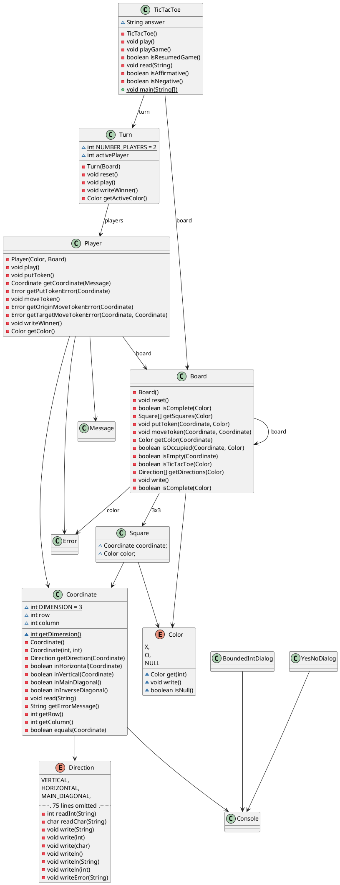

# Case E085

Diagram type: class · tier 4 · outcome: compiled low-structural
Image: `E085.png`

## Ground truth

```plantuml
' Blob ID: 83e0fd9a4e676366fc8045316d6f25c3f5784995
' Original Path: /tech-java-basadoObjetos/src/es/usantatecla/tictactoe/docs/classes.puml
' Source: World of Code

@startuml

class Board {
	+ Board() 
	+ void reset() 
	+ boolean isComplete(Color)
	- Square[] getSquares(Color)
	+ void putToken(Coordinate, Color)
	+ void moveToken(Coordinate, Coordinate) 
	- Color getColor(Coordinate) 
	+ boolean isOccupied(Coordinate, Color) 
	+ boolean isEmpty(Coordinate)
	+ boolean isTicTacToe(Color) 
	- Direction[] getDirections(Color)
	+ void write()
	+ boolean isComplete(Color)
}

class Square {
    - Coordinate coordinate;
    - Color color;
}


class BoundedIntDialog {
	- ClosedInterval LIMITS
	+ BoundedIntDialog(int, int)
	+ int read(String) 
	- String getLimits()
}

enum Color {
	X,
	O,
	NULL
	+ {static} Color get(int)
	+ void write() 
	+ boolean isNull()
}

class Console {
	- {static} Console instance = new Console()
	+ {static} Console getInstance()
	- BufferedReader bufferedReader
	+ String readString(String) 
	+ String readString()
	+ int readInt(String) 
	+ char readChar(String) 
	+ void write(String)
	+ void write(int)
	+ void write(char)
	+ void writeln()
	+ void writeln(String)
	+ void writeln(int) 
	+ void writeError(String) 
}

class Coordinate {
	- {static} int DIMENSION = 3
	- int row
	- int column
	+ {static} int getDimension()
	+ Coordinate() 
	+ Coordinate(int, int) 
	+ Direction getDirection(Coordinate)
	- boolean inHorizontal(Coordinate)
	- boolean inVertical(Coordinate)
	- boolean inMainDiagonal() 
	- boolean inInverseDiagonal() 
	+ void read(String)
	+ String getErrorMessage() 
	+ int getRow()
	+ int getColumn()
	+ boolean equals(Coordinate)
}

enum Direction {
	VERTICAL,
	HORIZONTAL,
	MAIN_DIAGONAL,
	INVERSE_DIAGONAL,
	NULL
	+ boolean isNull() 
}

enum Error {
	NOT_EMPTY
	NOT_OWNER
	SAME_COORDINATES
	WRONG_COORDINATES
	NULL
	- String message
	- Error()
	- Error(String)
	+ void writeln()
	+ boolean isNull()
}

enum Message {
	TITLE
	HORIZONTAL_LINE
	VERTICAL_LINE
	NULL_COLOR
	TURN
	ENTER_COORDINATE_TO_PUT
	COORDINATE_TO_PUT
	COORDINATE_TO_REMOVE
	COORDINATE_TO_MOVE
	ROW
	COLUMN
	BOUNDED_INT_ERROR
	LIMITS
	CLOSED_INTERVAL
	PLAYER_WIN
	RESUME
	YES_NO_SUFFIX
	YES_NO_ERROR
	+ {static} char AFFIRMATIVE
	+ {static} char NEGATIVE
	+ {static} String $COLOR
	+ {static} String $PLAYER
	+ {static} String $CLOSED_INTERVAL
	+ {static} String $MIN
	+ {static} String $MAX
	- String message
	- Message(String)
	+ void write()
	+ void writeln() 
	+ void writeln(String)
	+ String toString() 
}

class Player {
	+ Player(Color, Board)
	+ void play() 
	- void putToken()
	- Coordinate getCoordinate(Message) 
	- Error getPutTokenError(Coordinate)
	- void moveToken() 
	- Error getOriginMoveTokenError(Coordinate) 
	- Error getTargetMoveTokenError(Coordinate, Coordinate)
	+ void writeWinner() 
	+ Color getColor() 
}

class TicTacToe {
	- String answer
	- TicTacToe() 
	- void play() 
	- void playGame() 
	- boolean isResumedGame() 
	- void read(String)
	- boolean isAffirmative()
	- boolean isNegative() 
	+ {static} void main(String[])
}

class Turn {
	- {static} int NUMBER_PLAYERS = 2
	- int activePlayer
	+ Turn(Board) 
	+ void reset()
	+ void play()
	+ void writeWinner()
	+ Color getActiveColor() 
}

class ClosedInterval {
	- int min;
	- int max;
	+ ClosedInterval(int, int) 
	+ boolean isIncluded(int) 
	+ String toString()
	+ boolean equals(ClosedInterval)
}

TicTacToe ..> Message
TicTacToe *-down-> Turn : turn
TicTacToe *-down-> Board : board
Turn *-down-> "2" Player : players
Player -down-> Board : board
Player -down-> Color : color
Player ..> Error
Player ..> Message
Board *-down-> "3x3" Square

Square *--> Coordinate
Square ..> Color
Board..> Direction
Board ..> Message
Coordinate ..> Direction
Coordinate ..> BoundedIntDialog
BoundedIntDialog ..> ClosedInterval
YesNoDialog ..> Console
BoundedIntDialog ..> Console
Coordinate ..> Console
Board ..> Console
Color ..> Console
Message ..> Console
Error ..> Console
@enduml
```

## Answer (1 display-only lines removed; they are in `E085.stripped.txt`)

## Structural diff

Element F1 1.000 · Relationship F1 0.050

- nodes matched (14): `board`, `boundedintdialog`, `closedinterval`, `color`, `console`, `coordinate`, `direction`, `error`, `message`, `player`, `square`, `tictactoe`, `turn`, `yesnodialog`
- nodes missed (0): none
- nodes spurious (0): none
- edges matched (1): `player -> board : association (one arrowhead)`
- edges missed (22): `board -> console : dependency`, `board -> direction : dependency`, `board -> message : dependency`, `board -> square : composition`, `boundedintdialog -> closedinterval : dependency`, `boundedintdialog -> console : dependency`, `color -> console : dependency`, `coordinate -> boundedintdialog : dependency`, `coordinate -> console : dependency`, `coordinate -> direction : dependency`, `error -> console : dependency`, `message -> console : dependency`, `player -> color : association (one arrowhead)`, `player -> error : dependency`, `player -> message : dependency`, `square -> color : dependency`, `square -> coordinate : composition`, `tictactoe -> board : composition`, `tictactoe -> message : dependency`, `tictactoe -> turn : composition`, `turn -> player : composition`, `yesnodialog -> console : dependency`
- edges spurious (16): `board -> board : association (one arrowhead)`, `board -> color : association (one arrowhead)`, `board -> error : association (one arrowhead)`, `board -> square : association (one arrowhead)`, `boundedintdialog -> console : association (one arrowhead)`, `coordinate -> console : association (one arrowhead)`, `coordinate -> direction : association (one arrowhead)`, `player -> coordinate : association (one arrowhead)`, `player -> error : association (one arrowhead)`, `player -> message : association (one arrowhead)`, `square -> color : association (one arrowhead)`, `square -> coordinate : association (one arrowhead)`, `tictactoe -> board : association (one arrowhead)`, `tictactoe -> turn : association (one arrowhead)`, `turn -> player : association (one arrowhead)`, `yesnodialog -> console : association (one arrowhead)`
