# Case E086

Diagram type: class · tier 4 · outcome: compile fail
Image: `E086.png`

## Ground truth

```plantuml
' Blob ID: bd045dcdf9f93711b701665ba6c426c083ce0277
' Original Path: /DesignFiles/ClassDiagram.plantuml
' Source: World of Code

@startuml
title Facebook Smart View -  Class Diagram

interface IXmlSerializable {
    +ReadXml(XmlReader reader): void
    +WriteXml(XmlWriter writer): void
}

interface IEnumerable {
    +GetEnumerator(): IEnumerator
}

class FormMain extends Form {
    +event MainFormLoadEventArgs
}

class FormLogin extends Form {
}

class FormLoader extends Form {
}

class AppUser {
    +constructor(User)
    +GetNewsFeed(PostFilter): FacebookObjectCollection<Post>
    +GetUserAlbums(): FacebookObjectCollection<Album>
    +GetUserProfilePicture(): string
    +PostToUserWall(string): string
    +LikePhoto(string): bool
    +CommentPhoto(string, string): bool
    +Name: string {getter}
    +Birthday: string {getter}
    +Gender: string {getter}
    +Age: int {getter}
    +UserLivesIn: string {getter}
    +LastEducationStudyPlace: string {getter}

}

class LoginLogic{
    +constructor()
    +GetSavedAccessToken(): string
    +SaveAccessToken(string)
    +LoginToFacebook(): LoginResult
    +LoginToFacebookAndSaveToken(): LiginResult
    +ConnectToFacebook(string): LoginResult
    +SaveRememberBox(bool)
    +GetRememberBoxCheckedValue(): bool
}

FormMain *-down-AppUser

AppUser "1" o-down- "1" User: Holds the facebook user
AppUser "1" o-down- "*" Post
AppUser "1" o-down- "*" Album


FormLogin *-down-LoginLogic
FormLogin "1" -> "1" FormLoader
FormLogin "1" -down-> "1" FormMain

package "Post Filtering Feature" <<Frame>> {

    class PostFilter{
        +constructor()
        +AddGroup(FilterGroup)
        +RemoveGroup(FilterGroup)
        +Save()
        +FilterGroups: IList<FilterGroup> {getter, setter}
    }

    class FilterGroup implements IXmlSerializable, IEnumerable{
         -IList<FilterItem>
        +constructor()
        +AddItem(FilterItem)
        +RemoveItem(FilterItem)
        +IsMatch(Post): bool
        +Name: string {getter, setter}
    }

    class FilterItem  implements IXmlSerializable{
        +constructor()
        +constructor(Regex)
        +IsMatch(Post): bool
     }

     class FormPostFilterSettings extends Form{
        +PostFilter: PostFilter {getter, setter}
     }

     class FormFilterGroup extends Form{
        +GroupFilter: FilterGroup {getter, setter}
     }

    FilterGroup *- "*"FilterItem
    PostFilter *-up-"*" FilterGroup
    FormPostFilterSettings *-left- PostFilter
    FormFilterGroup  *-down- FilterGroup
    FormPostFilterSettings-left->FormFilterGroup 
    FormMain->"1"FormPostFilterSettings
    
}

package "Top Photos Feature" <<Frame>> {

class PopularPanelMgt{
    +CurrentObjectID: string {getter, setter}
    +InformationLabel: Label {getter, setter}
    +InformationTextbox: TextBox {getter, setter}
    +PictureObjectList: List<SpecialPictureBox> {getter}
    +Instance: static PopularPanelMgt {getter}
    -constructor()
    +SetPanels(Panel, Panel)
    +TryAddToPanel(SpecialPictureBox): bool
    -getNextFreeLocationInContainer(Size, out Point): bool
}
PopularPanelMgt "1"*-down- "*" SpecialPictureBox
FormMain *-up-PopularPanelMgt
}

class MainFormLoadEventArgs extends EventArgs {
    +constructor()
    +FinishedLoading: bool {getter, setter}
    +Message: string {getter, setter}
}

FormMain *-down-MainFormLoadEventArgs

package "Top Photos Feature" <<Frame>> {

class PictureObjectBasic{
    +constructor(string , int , int , int , string , string)
    +NumberOfLikes: int {getter, setter}
    +NumberOfComment: int {getter, setter}
    +PictureUrl: string {getter, setter}
    +Score: int {getter, setter}
    +ObjectId: string {getter, setter}
}

class PictureObject extends PictureObjectBasic {
    +constructor(string, int , int , int , string , string,  PictureBox , Label) 
    +LoadInformation()
}


class SpecialPictureBox extends PictureBox{
    +constructor(Panell)
    +SpecialPictureBoxOnClick(object, EventArgs)
    +UpdateNames(int)
    +RemoveObjectFromPanel()
    +OnMouseHover(EventArgs)
    +OnMouseLeave(EventArgs)
    +ObjectLocation: Point {getter, setter}
    +PictureBoxTopPhotosSize: static Size {getter}
    +PictureObject: PictureObject {getter, setter}
    +FatherPanel: Panel {getter}
    +PicLabel: Label {getter}
}


class TopPhotosFeature{
    +constructor(AppUser , ref List<SpecialPictureBox>)
    +RankUserPhotos()
    +LoadTopPhotos()
}


PictureObjectBasic "*" *-down- "1" FormMain
PictureObject "1" *-down- "1" SpecialPictureBox

TopPhotosFeature "1"*-up- "*" SpecialPictureBox
TopPhotosFeature "1"*-up- "*" PictureObjectBasic
AppUser *-down-TopPhotosFeature

}

@enduml
```



## Answer (1 display-only lines removed; they are in `E086.stripped.txt`)

```plantuml
@startuml

class Form

class FormLogin
class FormLoader

FormLogin --|> Form
FormLoader --|> Form

FormLogin "1" -- "1" FormLoader

class LoginLogic {
  + constructor()
  + GetSavedAccessToken(): string
  + SaveAccessToken(string)
  + LoginToFacebook(): LoginResult
  + LoginToFacebookAndSaveToken(): LoginResult
  + ConnectToFacebook(string): LoginResult
  + SaveRememberBox(bool)
  + GetRememberBoxCheckedValue(): bool
}

class FormMain {
  + event MainFormLoadEventArgs
}

class EventArgs

FormMain --|> Form
FormMain -- EventArgs

class MainFormLoadEventArgs {
  + FinishedLoading: bool {getter, setter}
  + Message: string {getter, setter}
  + constructor()
}

MainFormLoadEventArgs --|> EventArgs

class AppUser {
  + Name: string {getter}
  + Birthday: string {getter}
  + Gender: string {getter}
  + Age: int {getter}
  + UserLivesin: string {getter}
  + LastEducationStudyPlace: string {getter}
  + constructor(User)
  + GetNewsFeed(PostFilter): FacebookObjectCollection<Post>
  + GetUserAlbums(): FacebookObjectCollection<Album>
  + GetUserProfilePicture(): string
  + PostToUserWall(string): string
  + LikePhoto(string): bool
  + CommentPhoto(string, string): bool
}

class Album
class User
class Post

AppUser "1" -- "*" Album
AppUser "1" -- "1" User : Holds the facebook user
AppUser "1" -- "*" Post

package "Top Photos Feature" {
  class PictureObjectBasic {
    + NumberOfLikes: int {getter, setter}
    + NumberOfComment: int {getter, setter}
    + PictureUrl: string {getter, setter}
    + Score: int {getter, setter}
    + ObjectId: string {getter, setter}
    - constructor(string, int, int, int, string, string)
  }

  class PictureObject {
    - constructor(string, int, int, int, string, string, PictureBox, Label)
    + LoadInformation()
  }

  PictureObject --|> PictureObjectBasic
}

class PictureBox

class PopularPanelMgt {
  + CurrentObjectID: string {getter, setter}
  + InformationLabel: Label {getter, setter}
  + InformationTextbox: TextBox {getter, setter}
  + PictureObjectList: List<SpecialPictureBox> {getter}
  - static: PopularPanelMgt {getter}
... 71 lines omitted ...
  }

  FilterGroup ..|> IXmlSerializable
  FilterGroup ..|> IEnumerable
  FilterGroup --> FilterItem

  class PostFilter {
    + FilterGroups: List<FilterGroup> {getter, setter}
    + constructor()
    + AddGroup(FilterGroup)
    + RemoveGroup(FilterGroup)
    + Save()
  }

  class FormPostFilterSettings {
    + PostFilter: PostFilter {getter, setter}
  }

  FormPostFilterSettings --|> FormPF
  FormPostFilterSettings --> PostFilter

  PostFilter --> FilterGroup
}

FormMain --> PictureObjectBasic
FormMain --> PictureObject
FormMain --> TopPhotosFeature
FormMain --> AppUser

@enduml
```

## Renderer

Renderer: error at line 133 of the answer block: `class Form as FormPF`
