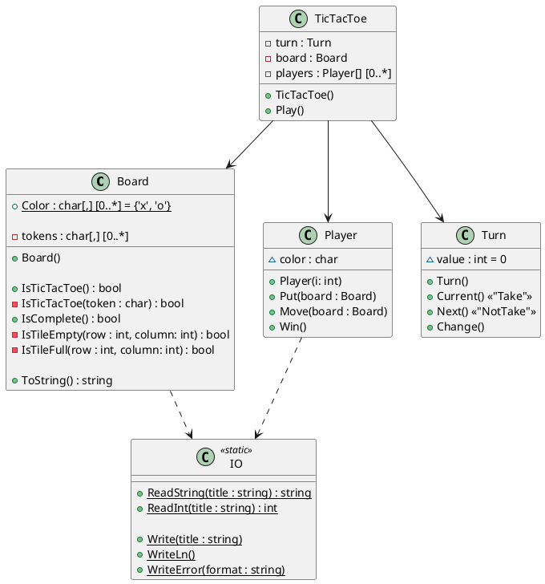
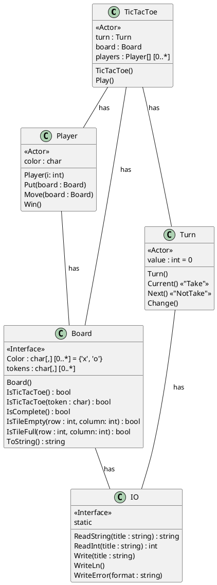

# Case E087

Diagram type: class · tier 3 · outcome: compiled low-structural
Image: `E087.png`

## Ground truth

## Answer (0 display-only lines removed; they are in `E087.stripped.txt`)

## Structural diff

Element F1 1.000 · Relationship F1 0.000

- nodes matched (5): `board`, `io`, `player`, `tictactoe`, `turn`
- nodes missed (0): none
- nodes spurious (0): none
- edges matched (0): none
- edges missed (5): `board -> io : dependency`, `player -> io : dependency`, `tictactoe -> board : association (one arrowhead)`, `tictactoe -> player : association (one arrowhead)`, `tictactoe -> turn : association (one arrowhead)`
- edges spurious (6): `board -> io : association`, `board -> player : association`, `board -> tictactoe : association`, `io -> turn : association`, `player -> tictactoe : association`, `tictactoe -> turn : association`
