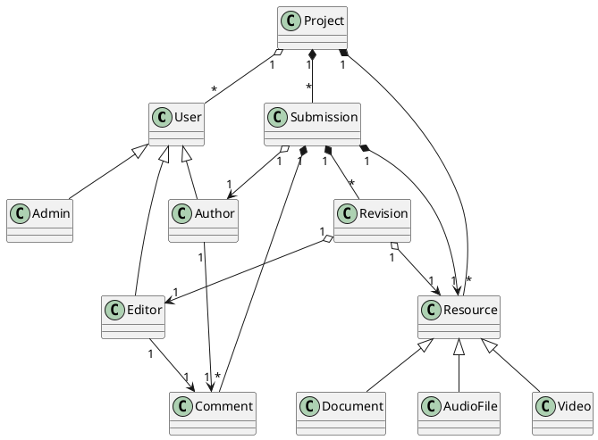

# Case E088

Diagram type: class · tier 2 · outcome: compile fail
Image: `E088.png`

## Ground truth



## Answer (0 display-only lines removed; they are in `E088.stripped.txt`)

```plantuml
@startuml
class Project
class User
class Submission
class Resource
class Revision
class Comment
class Author
class Editor
class Admin
class Document
class AudioFile
class Video

Project "1" *-- "*" User : 
Project "1" *-- "*" Submission : 
Project "1" *-- "*" Resource : 
Submission "1" *-- "*" Revision : 
Submission "1" *-- "*" Comment : 
Submission "1" o-- "1" Author : 
Submission "1" *-- "*" Resource : 
Revision "1" o-- "1" Editor : 
Revision "1" o-- "1" Resource : 
Comment "1" *-- "1" Editor : 
Comment "1" *-- "1" Author : 
User <|-- Admin : 
User <|-- Author : 
User <|-- Editor : 
Resource <|-- Document : 
Resource <|-- AudioFile : 
Resource <|-- Video : 

note "C" as n1
note "C" as n2
note "C" as n3
note "C" as n4
note "C" as n5
note "C" as n6
note "C" as n7
note "C" as n8
note "C" as n9
note "C" as n10
note "C" as n11
note "C" as n12
note "C" as n13
n1 -[hidden] Project
n2 -[hidden] User
n3 -[hidden] Submission
n4 -[hidden] Resource
n5 -[hidden] Revision
n6 -[hidden] Comment
n7 -[hidden] Author
n8 -[hidden] Editor
n9 -[hidden] Admin
n10 -[hidden] Document
n11 -[hidden] AudioFile
n12 -[hidden] Video
@enduml
```

## Renderer

Renderer: error at line 15 of the answer block: `Project "1" *-- "*" User :`
