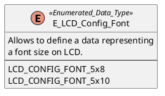
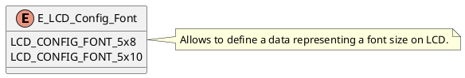

# Case E089

Diagram type: class · tier 1 · outcome: compiled low-structural
Image: `E089.png`

## Ground truth

## Answer (3 display-only lines removed; they are in `E089.stripped.txt`)

## Structural diff

Element F1 0.667 · Relationship F1 0.000

- nodes matched (1): `e_lcd_config_font`
- nodes missed (0): none
- nodes spurious (1): `allows to define a data representing a font size on lcd.`
- edges matched (0): none
- edges missed (0): none
- edges spurious (1): `e_lcd_config_font -> allows to define a data representing a font size on lcd. : dependency`
