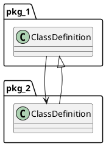

# Case E090

Diagram type: class · tier 1 · outcome: compile fail
Image: `E090.png`

## Ground truth



## Answer (0 display-only lines removed; they are in `E090.stripped.txt`)

```plantuml
@startuml
package pkg_1 {
  class ClassDefinition as c1
}

package pkg_2 {
  class ClassDefinition as c2
}

c1 --> c2
c2 -up-|> c1
@enduml
```

## Renderer

Renderer: error at line 3 of the answer block: `class ClassDefinition as c1`
