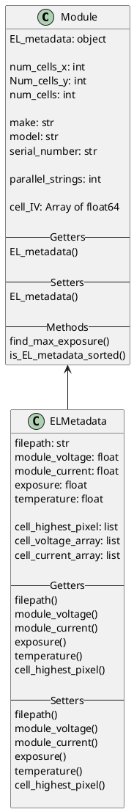
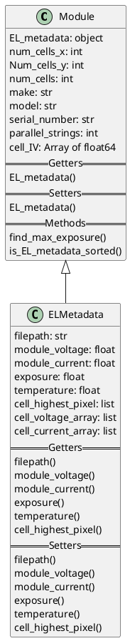

# Case E091

Diagram type: class · tier 3 · outcome: compiled low-structural
Image: `E091.png`

## Ground truth

## Answer (0 display-only lines removed; they are in `E091.stripped.txt`)

## Structural diff

Element F1 1.000 · Relationship F1 0.000

- nodes matched (2): `elmetadata`, `module`
- nodes missed (0): none
- nodes spurious (0): none
- edges matched (0): none
- edges missed (1): `elmetadata -> module : association (one arrowhead)`
- edges spurious (1): `elmetadata -> module : inheritance`
