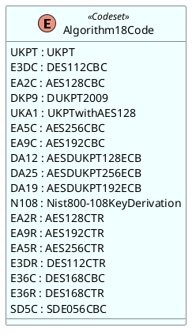
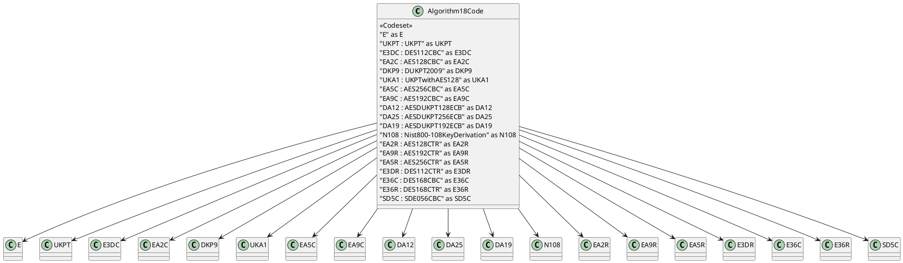

# Case E092

Diagram type: class · tier 2 · outcome: compiled low-structural
Image: `E092.png`

## Ground truth

## Answer (2 display-only lines removed; they are in `E092.stripped.txt`)

## Structural diff

Element F1 0.095 · Relationship F1 0.000

- nodes matched (1): `algorithm18code`
- nodes missed (0): none
- nodes spurious (19): `da12`, `da19`, `da25`, `dkp9`, `e`, `e36c`, `e36r`, `e3dc`, `e3dr`, `ea2c`, `ea2r`, `ea5c`, `ea5r`, `ea9c`, `ea9r`, `n108`, `sd5c`, `uka1`, `ukpt`
- edges matched (0): none
- edges missed (0): none
- edges spurious (19): `algorithm18code -> da12 : association (one arrowhead)`, `algorithm18code -> da19 : association (one arrowhead)`, `algorithm18code -> da25 : association (one arrowhead)`, `algorithm18code -> dkp9 : association (one arrowhead)`, `algorithm18code -> e : association (one arrowhead)`, `algorithm18code -> e36c : association (one arrowhead)`, `algorithm18code -> e36r : association (one arrowhead)`, `algorithm18code -> e3dc : association (one arrowhead)`, `algorithm18code -> e3dr : association (one arrowhead)`, `algorithm18code -> ea2c : association (one arrowhead)`, `algorithm18code -> ea2r : association (one arrowhead)`, `algorithm18code -> ea5c : association (one arrowhead)`, `algorithm18code -> ea5r : association (one arrowhead)`, `algorithm18code -> ea9c : association (one arrowhead)`, `algorithm18code -> ea9r : association (one arrowhead)`, `algorithm18code -> n108 : association (one arrowhead)`, `algorithm18code -> sd5c : association (one arrowhead)`, `algorithm18code -> uka1 : association (one arrowhead)`, `algorithm18code -> ukpt : association (one arrowhead)`
