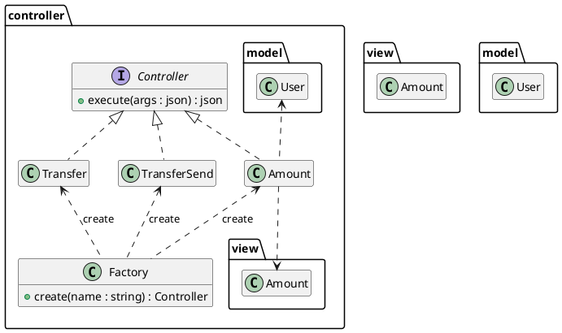

# Case E093

Diagram type: class · tier 3 · outcome: compile fail
Image: `E093.png`

## Ground truth



## Answer (0 display-only lines removed; they are in `E093.stripped.txt`)

```plantuml
@startuml

package "controller" {
    package "model" as controller_model {
        class User
    }

    interface Controller {
        + execute(args : json) : json
    }

    class Amount

    class TransferSend

    class Transfer

    package "view" as controller_view {
        class "Amount" as ViewAmount
    }

    class Factory {
        + create(name : string) : Controller
    }

    TransferSend ..|> Controller
    Transfer ..|> Controller
    Amount ..|> Controller

    Amount ..> User : 

    TransferSend ..> User : 

    Factory ..> Amount : create
    Factory ..> TransferSend : create
    Factory ..> Transfer : create

    Amount ..> ViewAmount
}

package "view" as ext_view {
    class "Amount" as ExtViewAmount
}

package "model" as ext_model {
    class "User" as ExtModelUser
}

@enduml
```

## Renderer

Renderer: error at line 30 of the answer block: `Amount ..> User :`
