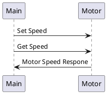
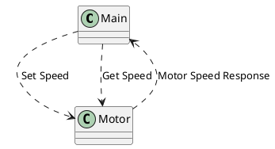

# Case E094

Diagram type: sequence · tier 1 · outcome: compiled low-structural
Image: `E094.png`

## Ground truth

## Answer (5 display-only lines removed; they are in `E094.stripped.txt`)

## Structural diff

Element F1 1.000 · Relationship F1 0.000

- nodes matched (2): `main`, `motor`
- nodes missed (0): none
- nodes spurious (0): none
- edges matched (0): none
- edges missed (3): `main -> motor : message` ×2, `motor -> main : message`
- edges spurious (3): `main -> motor : dependency` ×2, `motor -> main : dependency`
