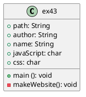

# Case E095

Diagram type: class · tier 1 · outcome: compile fail
Image: `E095.png`

## Ground truth



## Answer (2 display-only lines removed; they are in `E095.stripped.txt`)

```plantuml
@startuml
  path: String
  author: String
  name: String
  javaScript: char
  css: char
}

  main (): void
  makeWebsite(): void
}

class "C ex43" {
  CLASS_BODY
  CLASS_METHODS
}

@enduml
```

## Renderer

Renderer: error at line 8 of the answer block: `}`
