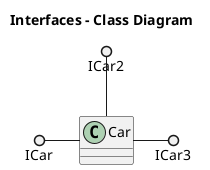
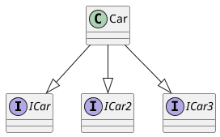

# Case E096

Diagram type: class · tier 1 · outcome: compiled low-structural
Image: `E096.png`

## Ground truth

## Answer (0 display-only lines removed; they are in `E096.stripped.txt`)

## Structural diff

Element F1 1.000 · Relationship F1 0.000

- nodes matched (4): `car`, `icar`, `icar2`, `icar3`
- nodes missed (0): none
- nodes spurious (0): none
- edges matched (0): none
- edges missed (3): `car -> icar : association`, `car -> icar2 : association`, `car -> icar3 : association`
- edges spurious (3): `car -> icar : inheritance`, `car -> icar2 : inheritance`, `car -> icar3 : inheritance`
