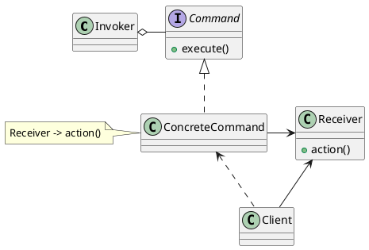
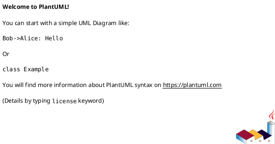

# Case E097

Diagram type: class · tier 2 · outcome: compile fail
Image: `E097.png`

## Ground truth

## Answer (438 display-only lines removed; they are in `E097.stripped.txt`)

## Renderer

The answer has no `@enduml`. Renderer: no PNG produced
