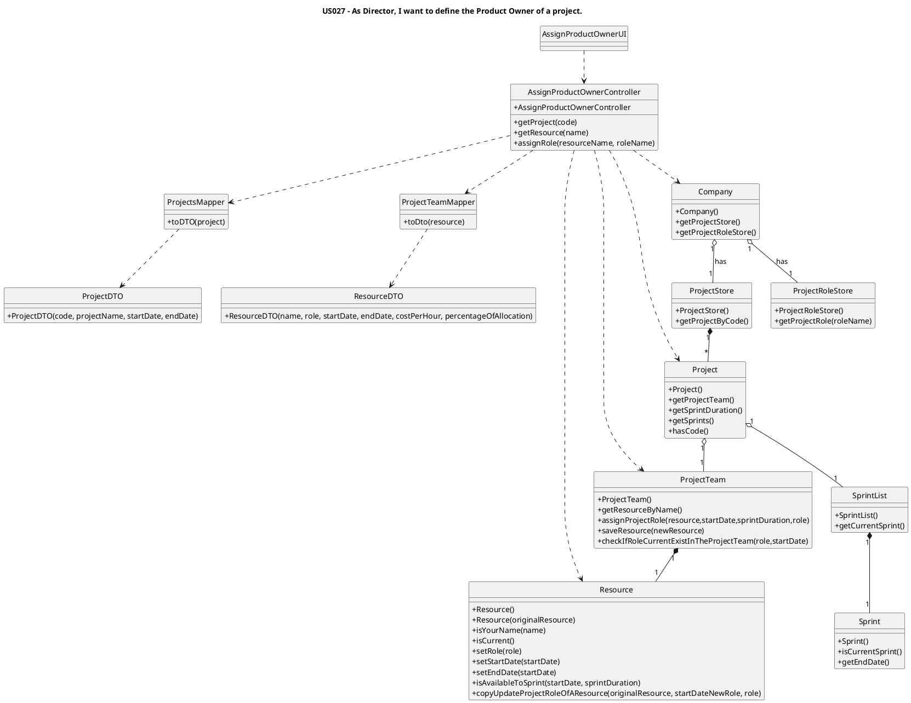

# Case E098

Diagram type: class · tier 4 · outcome: compile fail
Image: `E098.png`

## Ground truth



## Answer (1 display-only lines removed; they are in `E098.stripped.txt`)

```plantuml
@startuml

class AssignProductOwnerUI
class AssignProductOwnerController {
    +AssignProductOwnerController
    +getProject(code)
    +getResource(name)
    +assignRole(resourceName, roleName)
}

class ProjectsMapper {
    +toDTO(project)
}

class ProjectDTO {
    +ProjectDTO(code, projectName, startDate, endDate)
}

class ProjectTeamMapper {
    +toDto(resource)
}

class ResourceDTO {
    +ResourceDTO(name, role, startDate, endDate, costPerHour, percentageOfAllocation)
}

class Company {
    +Company()
    +getProjectStore()
    +getProjectRoleStore()
}

class ProjectStore {
    +ProjectStore()
    +getProjectByCode()
}

class ProjectRoleStore {
    +ProjectRoleStore()
    +getProjectRole(roleName)
}

class Project {
    +Project()
    +getProjectTeam()
    +getSprintDuration()
    +getSprints()
    +hasCode()
}

class ProjectTeam {
    +ProjectTeam()
    +getResourceByName()
    +assignProjectRole(resource, startDate, sprintDuration, role)
    +saveResource(newResource)
    +checkIfRoleCurrentExistInTheProjectTeam(role, startDate)
}

class Resource {
    +Resource()
    +Resource(originalResource)
    +isYourName(name)
    +isCurrent()
    +setRole(role)
    +setStartDate(startDate)
    +setEndDate(startDate)
    +isAvailableToSprint(startDate, sprintDuration)
    +copyUpdateProjectRoleOfAResource(originalResource, startDateNewRole, role)
}

class SprintList {
    +SprintList()
    +getCurrentSprint()
}

class Sprint {
    +Sprint()
    +isCurrentSprint()
    +getEndDate()
}

AssignProductOwnerUI ..> AssignProductOwnerController : 
AssignProductOwnerController ..> ProjectsMapper : 
AssignProductOwnerController ..> ProjectTeamMapper : 
AssignProductOwnerController ..> Company : 
AssignProductOwnerController ..> Project : 
AssignProductOwnerController ..> Resource : 
ProjectsMapper ..> ProjectDTO : 
ProjectTeamMapper ..> ResourceDTO : 
Company "1" --o "1" ProjectStore : has
Company "1" --o "1" ProjectRoleStore : has
ProjectStore "1" --o "*" Project : 
Project "1" --o "1" ProjectTeam : 
Project "1" --o "1" SprintList : 
ProjectTeam "1" --o "1" Resource : 
SprintList "1" --o "1" Sprint : 

@enduml
```

## Renderer

Renderer: error at line 83 of the answer block: `AssignProductOwnerUI ..> AssignProductOwnerController :`
