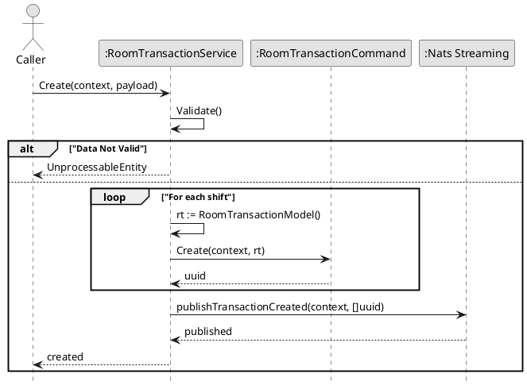
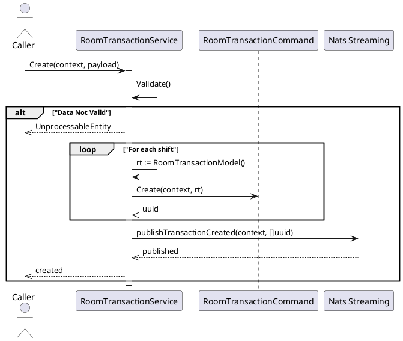

# Case E100

Diagram type: sequence · tier 2 · outcome: compiled low-structural
Image: `E100.png`

## Ground truth

## Answer (0 display-only lines removed; they are in `E100.stripped.txt`)

## Structural diff

Element F1 0.250 · Relationship F1 0.000

- nodes matched (1): `caller`
- nodes missed (3): `:nats streaming`, `:roomtransactioncommand`, `:roomtransactionservice`
- nodes spurious (3): `nats streaming`, `roomtransactioncommand`, `roomtransactionservice`
- edges matched (0): none
- edges missed (9): `:nats streaming -> :roomtransactionservice : message`, `:roomtransactioncommand -> :roomtransactionservice : message`, `:roomtransactionservice -> :nats streaming : message`, `:roomtransactionservice -> :roomtransactioncommand : message`, `:roomtransactionservice -> :roomtransactionservice : message` ×2, `:roomtransactionservice -> caller : message` ×2, `caller -> :roomtransactionservice : message`
- edges spurious (9): `caller -> roomtransactionservice : message`, `nats streaming -> roomtransactionservice : message`, `roomtransactioncommand -> roomtransactionservice : message`, `roomtransactionservice -> caller : message` ×2, `roomtransactionservice -> nats streaming : message`, `roomtransactionservice -> roomtransactioncommand : message`, `roomtransactionservice -> roomtransactionservice : message` ×2
