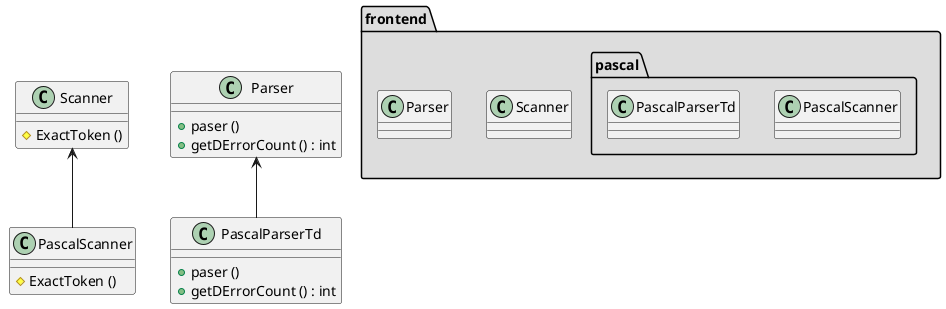
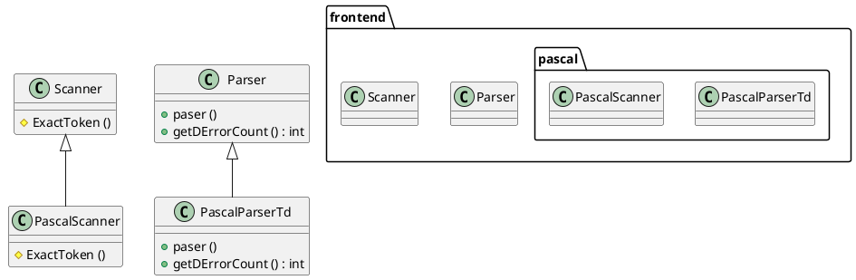

# Case E101

Diagram type: class · tier 2 · outcome: compiled low-structural
Image: `E101.png`

## Ground truth

## Answer (0 display-only lines removed; they are in `E101.stripped.txt`)

## Structural diff

Element F1 1.000 · Relationship F1 0.000

- nodes matched (8): `parser` ×2, `pascalparsertd` ×2, `pascalscanner` ×2, `scanner` ×2
- nodes missed (0): none
- nodes spurious (0): none
- edges matched (0): none
- edges missed (2): `pascalparsertd -> parser : association (one arrowhead)`, `pascalscanner -> scanner : association (one arrowhead)`
- edges spurious (2): `pascalparsertd -> parser : inheritance`, `pascalscanner -> scanner : inheritance`
