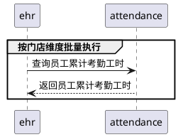
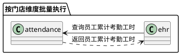

# Case E102

Diagram type: sequence · tier 1 · outcome: compiled low-structural
Image: `E102.png`

## Ground truth

## Answer (4 display-only lines removed; they are in `E102.stripped.txt`)

## Structural diff

Element F1 1.000 · Relationship F1 0.000

- nodes matched (2): `attendance`, `ehr`
- nodes missed (0): none
- nodes spurious (0): none
- edges matched (0): none
- edges missed (2): `attendance -> ehr : message`, `ehr -> attendance : message`
- edges spurious (2): `attendance -> ehr : dependency`, `ehr -> attendance : association (one arrowhead)`
