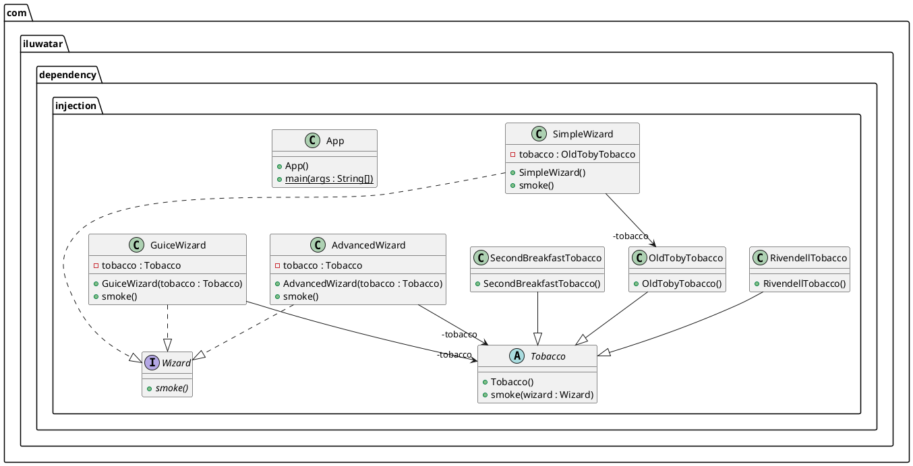

# Case E103

Diagram type: class · tier 3 · outcome: compile fail
Image: `E103.png`

## Ground truth



## Answer (0 display-only lines removed; they are in `E103.stripped.txt`)

```plantuml
@startuml
package com {
    class iluwatar {
    }
    class dependency {
    }
    class injection {
    }
}

class iluwatar {
}

class dependency {
}

class injection {
}

class App {
    +App()
    +main(args : String[])
}

class SimpleWizard {
    -tobacco : OldTobyTobacco
    +SimpleWizard()
    +smoke()
}

class AdvancedWizard {
    -tobacco : Tobacco
    +AdvancedWizard(tobacco : Tobacco)
    +smoke()
}

class GuiceWizard {
    -tobacco : Tobacco
    +GuiceWizard(tobacco : Tobacco)
    +smoke()
}

class RivendellTobacco {
    +RivendellTobacco()
}

class OldTobyTobacco {
    +OldTobyTobacco()
}

class SecondBreakfastTobacco {
    +SecondBreakfastTobacco()
}

class Tobacco {
    +Tobacco()
    +smoke(wizard : Wizard)
}

class Wizard {
    +smoke()
}

class App {
    +App()
    +main(args : String[])
}

class SimpleWizard {
    -tobacco : OldTobyTobacco
    +SimpleWizard()
    +smoke()
}

class AdvancedWizard {
    -tobacco : Tobacco
    +AdvancedWizard(tobacco : Tobacco)
    +smoke()
}

class GuiceWizard {
    -tobacco : Tobacco
    +GuiceWizard(tobacco : Tobacco)
    +smoke()
}

class RivendellTobacco {
    +RivendellTobacco()
}

... 980 lines omitted ...

class Wizard {
    +smoke()
}

class App {
    +App()
    +main(args : String[])
}

class SimpleWizard {
    -tobacco : OldTobyTobacco
    +SimpleWizard()
    +smoke()
}

class AdvancedWizard {
    -tobacco : Tobacco
    +AdvancedWizard(tobacco : Tobacco)
    +smoke()
}

class GuiceWizard {
    -tobacco : Tobacco
    +GuiceWizard(tobacco : Tobacco)
    +smoke()
}

class RivendellTobacco {
    +RivendellTobacco()
```

## Renderer

The answer has no `@enduml`. Renderer: no PNG produced
