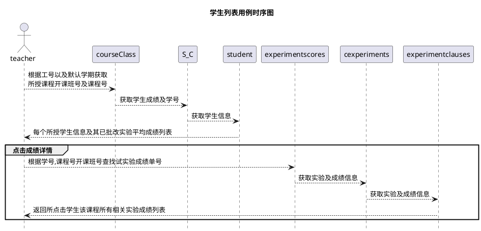

# Case E105

Diagram type: sequence · tier 2 · outcome: compile fail
Image: `E105.png`

## Ground truth



## Answer (1 display-only lines removed; they are in `E105.stripped.txt`)

```plantuml
@startuml

actor "teacher" as T

rectangle "courseClass" {
    "courseClass"
}

rectangle "S_C" {
    "S_C"
}

rectangle "student" {
    "student"
}

rectangle "experimentscores" {
    "experimentscores"
}

rectangle "cexperiments" {
    "cexperiments"
}

rectangle "experimentclauses" {
    "experimentclauses"
}

T --> courseClass: 根据工号以及默认学期获取
    所授课程开课班号及课程号

courseClass --> S_C: 获取学生成绩及学号

S_C --> student: 获取学生信息

student --> T: 每个所授学生信息及其已批改实验平均成绩列表

rectangle "点击成绩详情" {
    "点击成绩详情"
}

T --> experimentscores: 根据学号,课程号开课班号查找试实验成绩单号

experimentscores --> cexperiments: 获取实验及成绩信息

cexperiments --> experimentclauses: 获取实验及成绩信息

experimentclauses --> T: 返回所点击学生该课程所有相关实验成绩列表

@enduml
```

## Renderer

Renderer: error at line 7 of the answer block: `"courseClass"`
